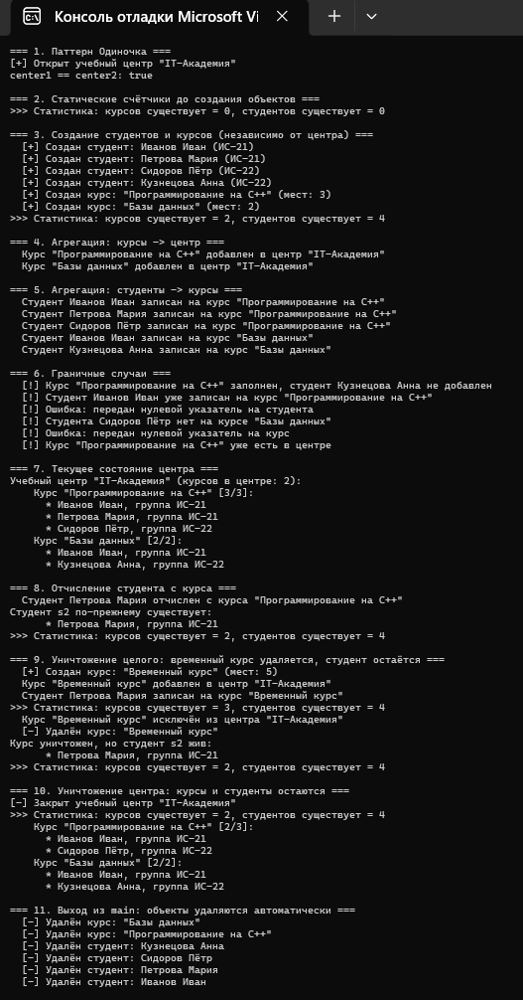

# Лабораторная работа №1
## Композиция и агрегация классов. Статические члены

**Студент:** Кулябцев Богдан Михайлович
**Группа:** ПИЖ-б-о-25-2
**Уровень сложности:** продвинутый
**Вариант:** 5

---

## Цель работы

Освоить проектирование отношений между классами (агрегация, композиция), понять разницу между ними с точки зрения времени жизни объектов, научиться использовать статические поля и методы для учёта объектов, реализовать паттерн «Одиночка» и закрепить навыки безопасного управления памятью в C++.

---

## Теоретическая часть

**Композиция** — отношение «часть–целое», при котором часть не может существовать без целого. Целое создаёт и уничтожает части, части умирают вместе с ним. В C++ реализуется полями-объектами, контейнерами объектов или `std::unique_ptr`.

**Агрегация** — отношение «часть–целое», при котором часть существует независимо от целого и может принадлежать нескольким целым. В C++ реализуется указателями или ссылками; деструктор целого части **не удаляет**. При работе с указателями обязательна проверка на `nullptr`.

| Характеристика | Ассоциация | Агрегация | Композиция |
|---|---|---|---|
| Сила связи | слабая | средняя | сильная |
| Время жизни частей | независимое | независимое | вместе с целым |
| Целое создаёт части | нет | нет | да |
| Целое уничтожает части | нет | нет | да |

**Статическое поле** принадлежит классу, а не объекту, и существует в единственном экземпляре. Определяется вне класса. **Статический метод** вызывается без объекта и не имеет доступа к `this`.

**Паттерн «Одиночка» (Singleton)** гарантирует, что у класса есть только один экземпляр. Реализуется приватным конструктором, статическим указателем на экземпляр, статическим методом `getInstance()` и запретом копирования.

---

## Постановка задачи

**Вариант 5.** Система управления курсами: `TrainingCenter` (одиночка) + `Course` (агрегация) + `Student` (агрегация в `Course`).

Необходимо:
1. Реализовать отношения агрегации: учебный центр → курсы, курс → студенты.
2. Добавить статическое поле для подсчёта объектов (реализованы счётчики студентов и курсов).
3. Реализовать паттерн «Одиночка» для класса `TrainingCenter`.
4. Продемонстрировать работу всех реализованных возможностей.

### Структура классов

| Класс | Роль | Связи |
|---|---|---|
| `TrainingCenter` | Одиночка | агрегирует `Course` (`vector<Course*>`) |
| `Course` | Часть центра и целое для студентов | агрегирует `Student` (`vector<Student*>`), статический счётчик `courseCount` |
| `Student` | Часть курса | независимый объект, статический счётчик `studentCount` |

### Реализованные возможности

- **Агрегация:** центр и курсы, курсы и студенты хранятся по указателям; деструкторы ничего не удаляют. Один студент может быть записан на несколько курсов.
- **Статические поля:** `Student::studentCount`, `Course::courseCount`.
- **Статические методы:** `Student::getStudentCount()`, `Course::getCourseCount()`, `TrainingCenter::getInstance()`, `TrainingCenter::destroyInstance()`.
- **Одиночка:** приватные конструктор и деструктор, удалены копирование и присваивание, ленивая инициализация, явное уничтожение через `destroyInstance()` (утечки памяти нет).
- **Граничные случаи:** `nullptr`, дубликат студента или курса, переполнение курса, удаление отсутствующего элемента, неположительная вместимость курса (заменяется на 1).

---

## Листинг программы (`main.cpp`)

```cpp
// Лабораторная работа №1. Композиция и агрегация классов. Статические члены
// Продвинутый уровень, вариант 5:
// Система управления курсами: TrainingCenter (одиночка)
//   + Course (агрегация) + Student (агрегация в Course)

#include <iostream>
#include <string>
#include <vector>
#include <algorithm>
#include <clocale>

using namespace std;

// ============================================================
// Класс Student - "часть" в агрегации с Course.
// Студент существует независимо от курса и может быть
// записан сразу на несколько курсов.
// ============================================================
class Student {
private:
    string name;   // ФИО студента
    string group;  // номер группы

    // Статическое поле: общий счётчик живых объектов Student
    static int studentCount;

public:
    Student(const string& n, const string& g) : name(n), group(g) {
        studentCount++;
        cout << "  [+] Создан студент: " << name << " (" << group << ")" << endl;
    }

    // Копирование запрещено: иначе счётчик студентов был бы неверным
    // (копия не увеличивала бы studentCount, а деструктор уменьшал бы).
    Student(const Student&) = delete;
    Student& operator=(const Student&) = delete;

    ~Student() {
        studentCount--;
        cout << "  [-] Удалён студент: " << name << endl;
    }

    const string& getName() const { return name; }
    const string& getGroup() const { return group; }

    void print() const {
        cout << "      * " << name << ", группа " << group << endl;
    }

    // Статический метод для работы со статическим полем
    static int getStudentCount() { return studentCount; }
};

// Определение статического поля (вне класса)
int Student::studentCount = 0;

// ============================================================
// Класс Course - "целое" для Student (агрегация)
// и "часть" для TrainingCenter (агрегация).
// Курс хранит только УКАЗАТЕЛИ на студентов и не удаляет их.
// ============================================================
class Course {
private:
    string title;                 // название курса
    int maxStudents;              // максимальное число студентов
    vector<Student*> students;    // агрегация: студенты живут независимо

    // Статическое поле: общий счётчик живых объектов Course
    static int courseCount;

public:
    Course(const string& t, int maxS) : title(t), maxStudents(maxS > 0 ? maxS : 1) {
        courseCount++;
        cout << "  [+] Создан курс: \"" << title << "\" (мест: " << maxStudents << ")" << endl;
    }

    Course(const Course&) = delete;
    Course& operator=(const Course&) = delete;

    ~Course() {
        courseCount--;
        cout << "  [-] Удалён курс: \"" << title << "\"" << endl;
        // Студенты НЕ удаляются - курс ими не владеет
    }

    const string& getTitle() const { return title; }
    int getStudentsCount() const { return static_cast<int>(students.size()); }

    // Добавление студента. Возвращает true при успехе.
    bool addStudent(Student* student) {
        // Проверка на nullptr (обязательна при агрегации)
        if (student == nullptr) {
            cout << "  [!] Ошибка: передан нулевой указатель на студента" << endl;
            return false;
        }
        // Проверка на дубликат
        if (find(students.begin(), students.end(), student) != students.end()) {
            cout << "  [!] Студент " << student->getName()
                 << " уже записан на курс \"" << title << "\"" << endl;
            return false;
        }
        // Проверка на переполнение курса
        if (static_cast<int>(students.size()) >= maxStudents) {
            cout << "  [!] Курс \"" << title << "\" заполнен, студент "
                 << student->getName() << " не добавлен" << endl;
            return false;
        }
        students.push_back(student);
        cout << "  Студент " << student->getName()
             << " записан на курс \"" << title << "\"" << endl;
        return true;
    }

    // Удаление студента с курса (сам объект Student НЕ уничтожается)
    bool removeStudent(Student* student) {
        if (student == nullptr) {
            cout << "  [!] Ошибка: передан нулевой указатель на студента" << endl;
            return false;
        }
        auto it = find(students.begin(), students.end(), student);
        if (it == students.end()) {
            cout << "  [!] Студента " << student->getName()
                 << " нет на курсе \"" << title << "\"" << endl;
            return false;
        }
        students.erase(it);
        cout << "  Студент " << student->getName()
             << " отчислен с курса \"" << title << "\"" << endl;
        return true;
    }

    void print() const {
        cout << "    Курс \"" << title << "\" [" << students.size()
             << "/" << maxStudents << "]:" << endl;
        if (students.empty()) {
            cout << "      (студентов нет)" << endl;
            return;
        }
        for (const Student* s : students) {
            s->print();
        }
    }

    // Статический метод для работы со статическим полем
    static int getCourseCount() { return courseCount; }
};

int Course::courseCount = 0;

// ============================================================
// Класс TrainingCenter - паттерн "Одиночка" (Singleton).
// Агрегирует курсы (хранит указатели, но не удаляет их).
// ============================================================
class TrainingCenter {
private:
    string name;
    vector<Course*> courses;  // агрегация: курсы живут независимо

    // Единственный экземпляр класса
    static TrainingCenter* instance;

    // Приватный конструктор - создать объект извне нельзя
    TrainingCenter(const string& n) : name(n) {
        cout << "[+] Открыт учебный центр \"" << name << "\"" << endl;
    }

    ~TrainingCenter() {
        cout << "[-] Закрыт учебный центр \"" << name << "\"" << endl;
        // Курсы НЕ удаляются
    }

public:
    // Запрет копирования и присваивания
    TrainingCenter(const TrainingCenter&) = delete;
    TrainingCenter& operator=(const TrainingCenter&) = delete;

    // Получение единственного экземпляра (ленивая инициализация)
    static TrainingCenter* getInstance(const string& n = "Учебный центр") {
        if (instance == nullptr) {
            instance = new TrainingCenter(n);
        }
        return instance;
    }

    // Явное уничтожение одиночки (чтобы не было утечки памяти)
    static void destroyInstance() {
        delete instance;
        instance = nullptr;
    }

    bool addCourse(Course* course) {
        if (course == nullptr) {
            cout << "  [!] Ошибка: передан нулевой указатель на курс" << endl;
            return false;
        }
        if (find(courses.begin(), courses.end(), course) != courses.end()) {
            cout << "  [!] Курс \"" << course->getTitle()
                 << "\" уже есть в центре" << endl;
            return false;
        }
        courses.push_back(course);
        cout << "  Курс \"" << course->getTitle()
             << "\" добавлен в центр \"" << name << "\"" << endl;
        return true;
    }

    bool removeCourse(Course* course) {
        if (course == nullptr) {
            cout << "  [!] Ошибка: передан нулевой указатель на курс" << endl;
            return false;
        }
        auto it = find(courses.begin(), courses.end(), course);
        if (it == courses.end()) {
            cout << "  [!] Курса \"" << course->getTitle()
                 << "\" нет в центре" << endl;
            return false;
        }
        courses.erase(it);
        cout << "  Курс \"" << course->getTitle()
             << "\" исключён из центра \"" << name << "\"" << endl;
        return true;
    }

    void print() const {
        cout << "Учебный центр \"" << name << "\" (курсов в центре: "
             << courses.size() << "):" << endl;
        if (courses.empty()) {
            cout << "    (курсов нет)" << endl;
            return;
        }
        for (const Course* c : courses) {
            c->print();
        }
    }
};

TrainingCenter* TrainingCenter::instance = nullptr;

// ============================================================
// Вспомогательная функция для вывода статистики
// ============================================================
void printStatistics() {
    cout << ">>> Статистика: курсов существует = " << Course::getCourseCount()
         << ", студентов существует = " << Student::getStudentCount() << endl;
}

// ============================================================
// Демонстрация
// ============================================================
int main() {
    setlocale(LC_ALL, "ru");

    cout << "=== 1. Паттерн Одиночка ===" << endl;
    TrainingCenter* center1 = TrainingCenter::getInstance("IT-Академия");
    TrainingCenter* center2 = TrainingCenter::getInstance("Другое имя");
    cout << "center1 == center2: " << (center1 == center2 ? "true" : "false") << endl;
    // TrainingCenter c;                        // ОШИБКА: конструктор приватный
    // TrainingCenter c3(*center1);             // ОШИБКА: копирование удалено

    cout << "\n=== 2. Статические счётчики до создания объектов ===" << endl;
    printStatistics();

    cout << "\n=== 3. Создание студентов и курсов (независимо от центра) ===" << endl;
    Student s1("Иванов Иван", "ИС-21");
    Student s2("Петрова Мария", "ИС-21");
    Student s3("Сидоров Пётр", "ИС-22");
    Student s4("Кузнецова Анна", "ИС-22");

    Course cpp("Программирование на C++", 3);
    Course db("Базы данных", 2);
    printStatistics();

    cout << "\n=== 4. Агрегация: курсы -> центр ===" << endl;
    center1->addCourse(&cpp);
    center1->addCourse(&db);

    cout << "\n=== 5. Агрегация: студенты -> курсы ===" << endl;
    cpp.addStudent(&s1);
    cpp.addStudent(&s2);
    cpp.addStudent(&s3);
    db.addStudent(&s1);   // один студент может быть на нескольких курсах
    db.addStudent(&s4);

    cout << "\n=== 6. Граничные случаи ===" << endl;
    cpp.addStudent(&s4);          // курс заполнен (3 из 3)
    cpp.addStudent(&s1);          // дубликат
    cpp.addStudent(nullptr);      // нулевой указатель
    db.removeStudent(&s3);        // студента нет на курсе
    center1->addCourse(nullptr);  // нулевой указатель
    center1->addCourse(&cpp);     // дубликат курса

    cout << "\n=== 7. Текущее состояние центра ===" << endl;
    center1->print();

    cout << "\n=== 8. Отчисление студента с курса ===" << endl;
    cpp.removeStudent(&s2);
    cout << "Студент s2 по-прежнему существует:" << endl;
    s2.print();
    printStatistics();

    cout << "\n=== 9. Уничтожение целого: временный курс удаляется, студент остаётся ===" << endl;
    {
        Course temp("Временный курс", 5);
        center1->addCourse(&temp);
        temp.addStudent(&s2);
        printStatistics();
        center1->removeCourse(&temp);
    } // temp уничтожается, студент s2 остаётся
    cout << "Курс уничтожен, но студент s2 жив:" << endl;
    s2.print();
    printStatistics();

    cout << "\n=== 10. Уничтожение центра: курсы и студенты остаются ===" << endl;
    TrainingCenter::destroyInstance();
    center1 = center2 = nullptr;  // обнуляем "висячие" указатели
    printStatistics();
    cpp.print();
    db.print();

    cout << "\n=== 11. Выход из main: объекты удаляются автоматически ===" << endl;
    return 0;
}
```

---

## Результаты работы

Вывод программы:

```text
=== 1. Паттерн Одиночка ===
[+] Открыт учебный центр "IT-Академия"
center1 == center2: true

=== 2. Статические счётчики до создания объектов ===
>>> Статистика: курсов существует = 0, студентов существует = 0

=== 3. Создание студентов и курсов (независимо от центра) ===
  [+] Создан студент: Иванов Иван (ИС-21)
  [+] Создан студент: Петрова Мария (ИС-21)
  [+] Создан студент: Сидоров Пётр (ИС-22)
  [+] Создан студент: Кузнецова Анна (ИС-22)
  [+] Создан курс: "Программирование на C++" (мест: 3)
  [+] Создан курс: "Базы данных" (мест: 2)
>>> Статистика: курсов существует = 2, студентов существует = 4

=== 4. Агрегация: курсы -> центр ===
  Курс "Программирование на C++" добавлен в центр "IT-Академия"
  Курс "Базы данных" добавлен в центр "IT-Академия"

=== 5. Агрегация: студенты -> курсы ===
  Студент Иванов Иван записан на курс "Программирование на C++"
  Студент Петрова Мария записан на курс "Программирование на C++"
  Студент Сидоров Пётр записан на курс "Программирование на C++"
  Студент Иванов Иван записан на курс "Базы данных"
  Студент Кузнецова Анна записан на курс "Базы данных"

=== 6. Граничные случаи ===
  [!] Курс "Программирование на C++" заполнен, студент Кузнецова Анна не добавлен
  [!] Студент Иванов Иван уже записан на курс "Программирование на C++"
  [!] Ошибка: передан нулевой указатель на студента
  [!] Студента Сидоров Пётр нет на курсе "Базы данных"
  [!] Ошибка: передан нулевой указатель на курс
  [!] Курс "Программирование на C++" уже есть в центре

=== 7. Текущее состояние центра ===
Учебный центр "IT-Академия" (курсов в центре: 2):
    Курс "Программирование на C++" [3/3]:
      * Иванов Иван, группа ИС-21
      * Петрова Мария, группа ИС-21
      * Сидоров Пётр, группа ИС-22
    Курс "Базы данных" [2/2]:
      * Иванов Иван, группа ИС-21
      * Кузнецова Анна, группа ИС-22

=== 8. Отчисление студента с курса ===
  Студент Петрова Мария отчислен с курса "Программирование на C++"
Студент s2 по-прежнему существует:
      * Петрова Мария, группа ИС-21
>>> Статистика: курсов существует = 2, студентов существует = 4

=== 9. Уничтожение целого: временный курс удаляется, студент остаётся ===
  [+] Создан курс: "Временный курс" (мест: 5)
  Курс "Временный курс" добавлен в центр "IT-Академия"
  Студент Петрова Мария записан на курс "Временный курс"
>>> Статистика: курсов существует = 3, студентов существует = 4
  Курс "Временный курс" исключён из центра "IT-Академия"
  [-] Удалён курс: "Временный курс"
Курс уничтожен, но студент s2 жив:
      * Петрова Мария, группа ИС-21
>>> Статистика: курсов существует = 2, студентов существует = 4

=== 10. Уничтожение центра: курсы и студенты остаются ===
[-] Закрыт учебный центр "IT-Академия"
>>> Статистика: курсов существует = 2, студентов существует = 4
    Курс "Программирование на C++" [2/3]:
      * Иванов Иван, группа ИС-21
      * Сидоров Пётр, группа ИС-22
    Курс "Базы данных" [2/2]:
      * Иванов Иван, группа ИС-21
      * Кузнецова Анна, группа ИС-22

=== 11. Выход из main: объекты удаляются автоматически ===
  [-] Удалён курс: "Базы данных"
  [-] Удалён курс: "Программирование на C++"
  [-] Удалён студент: Кузнецова Анна
  [-] Удалён студент: Сидоров Пётр
  [-] Удалён студент: Петрова Мария
  [-] Удалён студент: Иванов Иван
```

> Скрин результата



### Анализ результата

- **Блок 1.** Второй вызов `getInstance("Другое имя")` вернул тот же объект (`center1 == center2: true`), имя центра не изменилось — Одиночка работает.
- **Блоки 2–3.** Счётчики до создания объектов равны 0, после создания показывают 2 курса и 4 студента.
- **Блок 6.** Все граничные случаи обработаны без падения программы.
- **Блок 8.** После отчисления студента с курса сам объект `s2` остаётся жить, счётчик студентов не изменился (4).
- **Блок 9.** Уничтожение временного курса не затронуло студента `s2`: курсов стало 2, студентов по-прежнему 4.
- **Блок 10.** После уничтожения центра курсы и студенты продолжают существовать (счётчики 2 и 4) — это и есть агрегация.
- **Блок 11.** Оставшиеся объекты уничтожаются автоматически в порядке, обратном созданию.
- Проверка сборкой с `-fsanitize=address,leak` показала отсутствие утечек памяти.

---

## Ответы на контрольные вопросы

1. **Что такое композиция? Приведите пример.**
   Композиция — отношение «часть–целое», при котором часть не может существовать без целого, а целое полностью управляет её временем жизни. Часть создаётся вместе с целым и уничтожается вместе с ним. Пример: дом и комнаты (`House` содержит `vector<Room>`).

2. **Что такое агрегация? Чем она отличается от композиции?**
   Агрегация — отношение «часть–целое», при котором части могут существовать независимо от целого и принадлежать нескольким «целым» одновременно. Отличие: при композиции целое отвечает за создание и уничтожение частей, при агрегации — нет (целое хранит лишь указатели или ссылки). Пример: курс и студенты.

3. **Как реализовать композицию в C++? Приведите пример кода.**
   Через поле-объект, контейнер объектов или `std::unique_ptr`:
   ```cpp
   class House {
       vector<Room> rooms;                 // комнаты живут внутри дома
   };
   class Car {
       unique_ptr<Engine> engine;          // двигатель принадлежит машине
   public:
       Car(int hp) : engine(make_unique<Engine>(hp)) {}
   };
   ```

4. **Как реализовать агрегацию в C++? Приведите пример кода.**
   Через указатели или ссылки на объекты, созданные снаружи; деструктор целого их не удаляет:
   ```cpp
   class Course {
       vector<Student*> students;          // агрегация
   public:
       bool addStudent(Student* s) {
           if (s == nullptr) return false; // обязательная проверка
           students.push_back(s);
           return true;
       }
   };
   ```

5. **В чём разница между временем жизни частей при композиции и агрегации?**
   При композиции часть живёт ровно столько же, сколько целое (умирает вместе с ним, каскадное удаление). При агрегации время жизни части независимо: она может появиться раньше целого и пережить его.

6. **Что такое статическое поле класса? Чем оно отличается от обычного поля?**
   Статическое поле принадлежит классу, а не объекту, и существует в одном экземпляре, общем для всех объектов. Обычное поле создаётся отдельно для каждого объекта.

7. **Как объявить и определить статическое поле? Где оно хранится?**
   Объявляется в классе с ключевым словом `static`, определяется один раз вне класса: `int Student::studentCount = 0;`. Хранится в статической области памяти (сегмент данных), а не внутри объектов.

8. **Что такое статический метод? Можно ли из него обратиться к нестатическим полям?**
   Статический метод вызывается без объекта (`Student::getStudentCount()`). У него нет указателя `this`, поэтому напрямую обращаться к нестатическим полям нельзя — только к статическим (либо через явно переданный объект).

9. **Для чего используются статические счётчики объектов?**
   Для учёта числа существующих экземпляров класса: увеличиваются в конструкторе, уменьшаются в деструкторе. В работе так считаются студенты (`Student::studentCount`) и курсы (`Course::courseCount`).

10. **Что такое паттерн «Одиночка» (Singleton)? Для чего он нужен?**
    Порождающий паттерн, гарантирующий существование только одного экземпляра класса и дающий к нему глобальную точку доступа. Нужен для ресурсов, которые должны быть единственными (в работе — учебный центр).

11. **Как запретить создание копий объекта (конструктор копирования)?**
    Удалить конструктор копирования и оператор присваивания: `Singleton(const Singleton&) = delete; Singleton& operator=(const Singleton&) = delete;`. Для одиночки конструктор делают ещё и приватным.

12. **В каком порядке вызываются конструкторы и деструкторы при композиции?**
    Сначала конструируются части (в порядке объявления полей), затем выполняется тело конструктора целого. Деструкторы вызываются в обратном порядке: сначала тело деструктора целого, затем деструкторы частей в порядке, обратном объявлению.

13. **Можно ли изменить статическое поле из обычного метода?**
    Да. Обычные методы имеют доступ и к статическим полям (так конструктор увеличивает счётчик `studentCount++`).

14. **Почему статические поля нужно определять вне класса?**
    Объявление в классе только описывает поле, но не выделяет под него память. Поскольку заголовок с классом может подключаться во многие файлы, определение (выделение памяти) должно быть ровно одно — в одном `.cpp`-файле. (Начиная с C++17 можно использовать `inline static`.)

15. **В каких случаях стоит использовать композицию, а в каких — агрегацию?**
    Композицию — когда часть не имеет смысла без целого (дом–комнаты, книга–главы). Агрегацию — когда части самостоятельны, могут переходить между «целыми» или использоваться несколькими (курс–студенты, библиотека–книги).

---

## Вывод

В ходе работы я изучил отношения между классами и на практике реализовал агрегацию на трёх уровнях: учебный центр → курсы → студенты. Выяснил, что при агрегации целое не отвечает за уничтожение частей, поэтому в деструкторах нет `delete`, а при приёме указателей обязательна проверка на `nullptr`, дубликаты и переполнение. Научился использовать статические поля и методы для подсчёта объектов, определять статические поля вне класса и запрещать копирование классов, для которых счётчик станет некорректным. Реализовал паттерн «Одиночка» с приватным конструктором, удалённым копированием и явным уничтожением экземпляра, что исключает утечку памяти.
