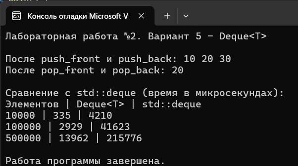

# Лабораторная работа №2
## Анализ сложности алгоритмов. Шаблоны классов

**Студент:** Кулябцев Богдан Михайлович  
**Группа:** ПИЖ-б-о-25-2  
**Уровень сложности:** продвинутый  
**Вариант:** 5

---

## Цель работы

Изучить шаблоны классов C++, реализовать шаблонный контейнер «двусторонняя очередь» `Deque<T>`, определить сложность его операций и сравнить производительность собственной реализации со стандартным контейнером `std::deque`.

---

## Теоретическая часть

**О-нотация (Big O)** описывает, как растёт время выполнения алгоритма или объём используемой памяти при увеличении количества входных данных. Она позволяет сравнивать алгоритмы независимо от конкретного компьютера.

**Шаблон класса** позволяет описать класс, который работает с разными типами данных. В записи `template <typename T>` параметр `T` обозначает тип, который будет указан при создании объекта, например `Deque<int>`.

**Двусторонняя очередь (deque)** — структура данных, в которой элементы можно добавлять и удалять как в начале, так и в конце.

**Амортизированная сложность** учитывает стоимость последовательности операций. Вставка обычно выполняется за `O(1)`, но при заполнении массива требуется расширение и перенос элементов за `O(n)`. При многократных вставках средняя стоимость одной вставки остаётся `O(1)`.

---

## Постановка задачи

**Продвинутый уровень, вариант 5.** Реализовать шаблонный контейнер `Deque<T>` со следующими операциями:

1. `push_front` — добавить элемент в начало;
2. `push_back` — добавить элемент в конец;
3. `pop_front` — удалить первый элемент;
4. `pop_back` — удалить последний элемент;
5. `operator[]` — получить элемент по индексу.

Провести анализ сложности каждой операции и экспериментально сравнить производительность со стандартным аналогом STL — `std::deque`.

### Структура контейнера

| Элемент | Назначение |
|---|---|
| `data` | Динамический массив для хранения элементов |
| `capacity` | Вместимость выделенного массива |
| `count` | Текущее количество элементов |
| `head` | Индекс первого элемента |
| `grow()` | Увеличивает массив в два раза и переносит элементы по порядку |

### Реализованные возможности

- Шаблонный класс `Deque<T>`.
- Добавление элементов в начало и конец.
- Удаление элементов с начала и конца.
- Доступ к элементам по индексу через `operator[]`.
- Проверка попытки удаления из пустого дека и обращения по неверному индексу.
- Сравнение времени выполнения со `std::deque`.

---

## Листинг программы (`main.cpp`)

```cpp
// Лабораторная работа №2. Продвинутый уровень, вариант 5.
// Шаблонный контейнер Deque<T> — двусторонняя очередь.

#include <iostream>
#include <deque>
#include <chrono>
#include <iomanip>
#include <stdexcept>
#include <clocale>

using namespace std;

// Дек хранит элементы в циклическом динамическом массиве.
template <typename T>
class Deque {
private:
    T* data;                 // Массив с элементами
    size_t capacity;         // Вместимость массива
    size_t count;            // Количество элементов
    size_t head;             // Индекс первого элемента

    // Увеличение массива в два раза. Выполняется только когда массив заполнен.
    void grow() {
        size_t newCapacity = capacity * 2;
        T* newData = new T[newCapacity];

        // Переносим элементы в новый массив в правильном порядке.
        for (size_t i = 0; i < count; ++i) {
            newData[i] = data[(head + i) % capacity];
        }

        delete[] data;
        data = newData;
        capacity = newCapacity;
        head = 0;
    }

public:
    // Создание пустого дека.
    Deque() : data(new T[4]), capacity(4), count(0), head(0) {}

    // Освобождение памяти.
    ~Deque() {
        delete[] data;
    }

    // Добавить элемент в конец.
    void push_back(const T& value) {
        if (count == capacity) grow();
        data[(head + count) % capacity] = value;
        ++count;
    }

    // Добавить элемент в начало.
    void push_front(const T& value) {
        if (count == capacity) grow();
        head = (head + capacity - 1) % capacity;
        data[head] = value;
        ++count;
    }

    // Удалить последний элемент.
    void pop_back() {
        if (count == 0) throw out_of_range("Deque пуст");
        --count;
    }

    // Удалить первый элемент.
    void pop_front() {
        if (count == 0) throw out_of_range("Deque пуст");
        head = (head + 1) % capacity;
        --count;
        if (count == 0) head = 0;
    }

    // Получить элемент по логическому индексу.
    T& operator[](size_t index) {
        if (index >= count) throw out_of_range("Неверный индекс");
        return data[(head + index) % capacity];
    }

    // Количество элементов — вспомогательный метод для проверки и тестирования.
    size_t size() const {
        return count;
    }
};

// Измерение времени выполнения одинаковой последовательности операций.
template <typename Container>
long long testTime(size_t n) {
    Container values;
    auto start = chrono::high_resolution_clock::now();

    for (size_t i = 0; i < n; ++i) {
        if (i % 2 == 0) values.push_back(static_cast<int>(i));
        else values.push_front(static_cast<int>(i));
    }

    // Обращаемся к элементам по индексу.
    long long sum = 0;
    for (size_t i = 0; i < values.size(); i += (values.size() / 10 + 1)) {
        sum += values[i];
    }

    while (values.size() > 0) {
        if (values.size() % 2 == 0) values.pop_front();
        else values.pop_back();
    }

    auto finish = chrono::high_resolution_clock::now();
    (void)sum;
    return chrono::duration_cast<chrono::microseconds>(finish - start).count();
}

int main() {
    setlocale(LC_ALL, "Russian");

    cout << "Лабораторная работа №2. Вариант 5 — Deque<T>\n\n";

    Deque<int> numbers;
    numbers.push_back(20);
    numbers.push_front(10);
    numbers.push_back(30);

    cout << "После push_front и push_back: ";
    for (size_t i = 0; i < numbers.size(); ++i) cout << numbers[i] << " ";

    numbers.pop_front();
    numbers.pop_back();
    cout << "\nПосле pop_front и pop_back: ";
    for (size_t i = 0; i < numbers.size(); ++i) cout << numbers[i] << " ";

    cout << "\n\nСравнение с std::deque (время в микросекундах):\n";
    cout << "Элементов | Deque<T> | std::deque\n";

    const size_t testSizes[] = {10000, 100000, 500000};
    for (size_t n : testSizes) {
        cout << n << " | " << testTime<Deque<int>>(n)
             << " | " << testTime<deque<int>>(n) << '\n';
    }

    cout << "\nРабота программы завершена.\n";
    return 0;
}
```

---

## Результаты работы

### Вывод программы

```text
Лабораторная работа №2. Вариант 5 — Deque<T>

После push_front и push_back: 10 20 30 
После pop_front и pop_back: 20 

Сравнение с std::deque (время в микросекундах):
Элементов | Deque<T> | std::deque
10000 | 335 | 4210
100000 | 2929 | 41623
500000 | 13962 | 215776

Работа программы завершена.
```

> Скрин результата


### Анализ результата

В демонстрационной части сначала добавляются элементы `20` и `30` в конец, а `10` — в начало. Поэтому содержимое дека становится `10 20 30`. После удаления первого и последнего элементов остаётся `20`.

Для экспериментального сравнения оба контейнера выполняют одинаковую последовательность действий: добавляют элементы попеременно в начало и конец, обращаются к нескольким элементам по индексу, затем удаляют элементы с обоих концов. Время измеряется в микросекундах с помощью библиотеки `std::chrono`.

В данном запуске стандартный `std::deque` показал меньшее время выполнения. Значения времени зависят от компьютера и конкретного запуска, поэтому при повторном измерении они могут отличаться.


## Ответы на контрольные вопросы

1. **Что такое О-нотация (Big O) и зачем она нужна?**  
   Это способ описать, как растёт время работы или расход памяти алгоритма при увеличении входных данных. Она нужна для сравнения эффективности алгоритмов.

2. **Какая сложность у доступа к элементу массива по индексу? Почему?**  
   `O(1)`, потому что адрес элемента вычисляется напрямую по индексу без перебора остальных элементов.

3. **Какая сложность у бинарного поиска? Почему?**  
   `O(log n)`, потому что на каждом шаге область поиска уменьшается примерно в два раза. Массив должен быть отсортирован.

4. **Что означает сложность `O(n log n)`? Приведите пример алгоритма.**  
   Время растёт примерно пропорционально `n` умножить на `log n`. Пример — сортировка слиянием.

5. **Что такое амортизированный анализ? Приведите пример.**  
   Это оценка средней стоимости последовательности операций. Например, добавление в динамический массив обычно занимает `O(1)`, но иногда расширение массива требует `O(n)`.

6. **Какая сложность у двух вложенных циклов по n итераций каждый?**  
   `O(n²)`, поскольку внутренний цикл выполняется `n` раз для каждой из `n` итераций внешнего цикла.

7. **Какая сложность у рекурсивного вычисления чисел Фибоначчи?**  
   У простого рекурсивного алгоритма без запоминания результатов — экспоненциальная, `O(2ⁿ)`.

8. **Что такое шаблоны функций? Как их объявить и использовать?**  
   Это функции, параметризованные типом. Например: `template <typename T> T maxValue(T a, T b)`. Компилятор создаёт нужную версию при вызове с конкретным типом.

9. **Что такое шаблоны классов? Как их объявить и использовать?**  
   Это классы, в которых тип данных задаётся параметром шаблона. В работе объявлен `template <typename T> class Deque`, а используется, например, как `Deque<int>`.

10. **В чём преимущество шаблонов перед перегрузкой функций?**  
    Шаблон позволяет написать одну универсальную реализацию для множества типов вместо отдельной функции или класса для каждого типа.

11. **Как указать, что шаблонный параметр — тип?**  
    С помощью `typename` или `class`, например `template <typename T>`.

12. **Можно ли создать шаблон с несколькими параметрами типов?**  
    Да. Например: `template <typename K, typename V> class Pair`.

13. **Как провести экспериментальное измерение времени выполнения?**  
    Зафиксировать время до выполнения операций и после них, затем вычислить разницу. В C++ для этого можно использовать `std::chrono`.

14. **Почему при измерении времени нужно выполнять операцию многократно?**  
    Потому что одна операция может выполняться слишком быстро для точного измерения. Повторение уменьшает влияние случайных задержек и погрешности таймера.

15. **Что важнее: сложность алгоритма или константа?**  
    Важны обе характеристики. На больших объёмах данных обычно важнее асимптотическая сложность, а на небольших объёмах и при близкой сложности заметную роль могут играть константы и особенности реализации.

---

## Вывод

В ходе лабораторной работы был реализован шаблонный контейнер `Deque<T>` на основе циклического динамического массива. Реализованы все операции, предусмотренные вариантом 5: добавление и удаление элементов с обоих концов, а также доступ по индексу. Изучена сложность операций: вставки имеют амортизированную сложность `O(1)`, удаление с обоих концов и доступ по индексу — `O(1)`, расширение массива — `O(n)`. Проведено экспериментальное сравнение собственной реализации со стандартным контейнером `std::deque`.

---
