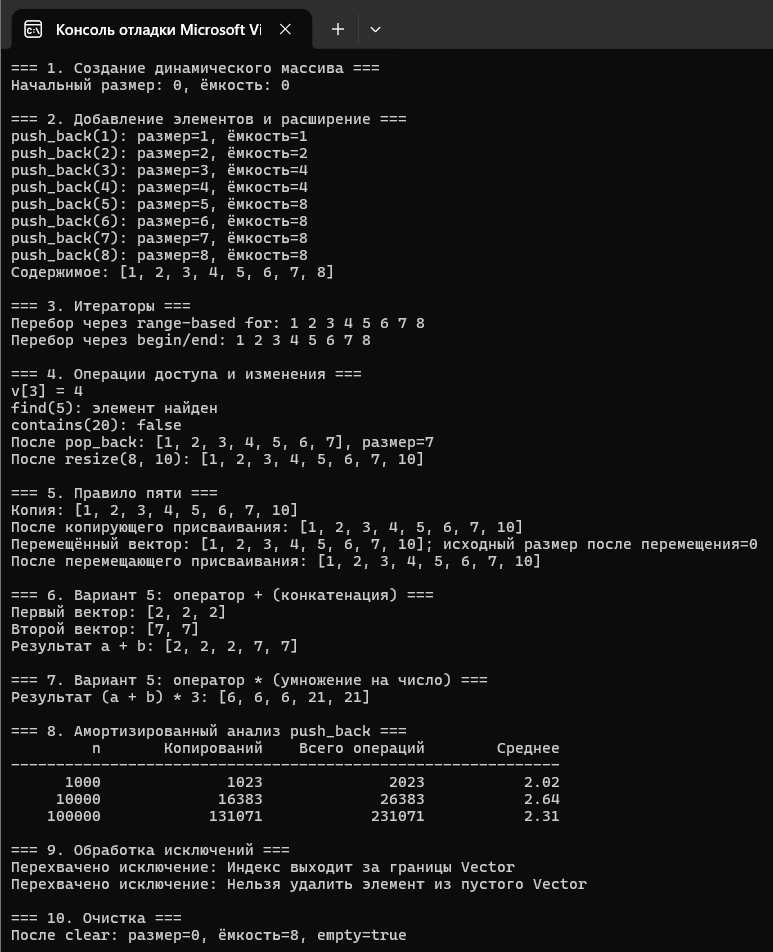

# Лабораторная работа №3
## Реализация динамического массива (аналог vector). Итераторы

**Студент:** Кулябцев Богдан Михайлович  
**Группа:** ПИЖ-б-о-25-2  
**Уровень сложности:** продвинутый  
**Вариант:** 5

---

## Цель работы

Реализовать с нуля шаблонный класс `Vector<T>`, аналогичный `std::vector`, освоить управление динамической памятью и принципы RAII, закрепить правило трёх и правило пяти, реализовать итераторы для перебора элементов, а также изучить амортизированную сложность операции `push_back`. Дополнительно реализовать функциональность согласно индивидуальному варианту.

---

## Теоретическая часть

### 1. Динамический массив

**Динамический массив** — структура данных, которая хранит элементы в непрерывной области памяти и позволяет изменять количество элементов во время выполнения программы. В отличие от обычного массива фиксированного размера, динамический массив может автоматически выделять дополнительную память при заполнении.

| Характеристика | Статический массив | Динамический массив (`Vector`) |
|---|---|---|
| Размер | Фиксированный | Изменяется во время выполнения |
| Память | Обычно стек или статическая область | Динамическая память (heap) |
| Расширение | Невозможно без создания нового массива | Выполняется при необходимости |
| Добавление в конец | Невозможно при заполнении | O(1) амортизированно |

### 2. Размер и ёмкость

- **`size`** — фактическое количество элементов, находящихся в контейнере.
- **`capacity`** — количество элементов, для которых уже выделена память.

Ёмкость может быть больше размера. Это позволяет добавлять новые элементы без выделения памяти при каждой операции.

### 3. Управление динамической памятью

Для хранения элементов используется динамически выделенный массив. Память выделяется при создании или расширении контейнера и освобождается в деструкторе.

При увеличении ёмкости создаётся новый массив, элементы переносятся в него, после чего старая память освобождается. В реализации используется временный `std::unique_ptr<T[]>`: если при выделении или копировании возникнет исключение, временная память будет освобождена автоматически. Это соответствует принципу RAII.

### 4. Амортизированный анализ `push_back`

При заполнении массива ёмкость увеличивается в два раза: 1, 2, 4, 8, 16 и так далее. Отдельная операция расширения требует O(n) времени, поскольку элементы необходимо скопировать. Однако расширения происходят всё реже.

За n добавлений суммарно выполняется линейное количество копирований, поэтому средняя стоимость одной операции `push_back` составляет **O(1) амортизированно**. В худшем случае отдельное добавление может иметь сложность O(n).

### 5. Правило трёх и правило пяти

**Правило трёх** применяется к классам, которые самостоятельно управляют ресурсами. Если классу необходим один из следующих методов, обычно необходимы все три:
- деструктор;
- конструктор копирования;
- оператор присваивания копированием.

**Правило пяти** расширяет правило трёх двумя операциями перемещения:
- конструктор перемещения;
- оператор присваивания перемещением.

Копирование создаёт независимую копию данных (глубокое копирование). Перемещение передаёт владение ресурсом без копирования всего массива и оставляет исходный объект в корректном пустом состоянии.

### 6. Итераторы

**Итератор** — объект, позволяющий последовательно обращаться к элементам контейнера. В данной реализации итераторами выступают обычные указатели на элементы массива.

- `begin()` возвращает указатель на первый элемент.
- `end()` возвращает указатель на позицию сразу после последнего элемента.

Такая пара методов позволяет использовать range-based for и стандартные алгоритмы, работающие с диапазонами итераторов.

---

## Постановка задачи

**Продвинутый уровень, вариант 5.**

Общее задание: реализовать шаблонный класс `Vector<T>` с поддержкой правила пяти, итераторами и дополнительной функциональностью согласно варианту.

Для варианта 5 необходимо перегрузить:
1. **Оператор `+`** — конкатенация (объединение) двух векторов.
2. **Оператор `*`** — умножение каждого элемента вектора на число.

Также в соответствии со средним уровнем для варианта 5 реализованы методы `find()` (поиск элемента по значению) и `contains()` (проверка наличия элемента).

### Реализованные возможности

- **Управление памятью:** динамическое выделение массива, увеличение ёмкости, освобождение памяти в деструкторе.
- **Конструкторы:** по умолчанию, с размером, с размером и значением, копирования и перемещения.
- **Правило пяти:** деструктор, копирующий и перемещающий конструкторы, копирующий и перемещающий операторы присваивания.
- **Безопасность:** проверка размера и индекса, обработка пустого контейнера, защита от самоприсваивания, применение `std::unique_ptr<T[]>` при выделении временной памяти.
- **Основные методы:** `size()`, `capacity()`, `empty()`, `reserve()`, `push_back()`, `pop_back()`, `resize()`, `clear()`.
- **Итераторы:** `begin()` и `end()`, поддержка `const`-объектов и range-based for.
- **Дополнительные методы:** `find()` и `contains()`.
- **Операторы варианта 5:** `operator+` и `operator*`.
- **Демонстрация:** копирование и перемещение, конкатенация, умножение, поиск, расширение массива и амортизированный анализ.

### Структура класса

| Компонент | Назначение |
|---|---|
| `data` | Указатель на динамический массив элементов |
| `sz` | Текущий размер контейнера |
| `cap` | Выделенная ёмкость |
| `copyCount` | Счётчик копирований элементов при расширении |
| `begin()`, `end()` | Итераторы для перебора элементов |
| `operator+` | Объединение двух векторов |
| `operator*` | Умножение элементов на заданное число |
| `find()`, `contains()` | Поиск и проверка наличия значения |

---

## Листинг программы (`lab3.cpp`)

Полный листинг программы с комментариями:

```cpp
// Лабораторная работа №3. Реализация динамического массива. Итераторы
// Продвинутый уровень, вариант 5:
// Vector<T> + оператор конкатенации (+) + умножение на число (*)

#include <iostream>
#include <stdexcept>
#include <algorithm>
#include <iomanip>
#include <clocale>
#include <memory>

using namespace std;

// ============================================================
// Шаблонный класс Vector - динамический массив.
// Реализованы правило пяти, итераторы и операторы варианта 5.
// ============================================================
template <typename T>
class Vector {
private:
    T* data;             // указатель на динамический массив
    int sz;              // текущее количество элементов
    int cap;             // выделенная ёмкость
    long long copyCount; // количество копирований при расширении

public:
    // Конструктор по умолчанию
    Vector() : data(nullptr), sz(0), cap(0), copyCount(0) {}

    // Конструктор размера
    explicit Vector(int n) : data(nullptr), sz(0), cap(0), copyCount(0) {
        if (n < 0) {
            throw invalid_argument("Размер не может быть отрицательным");
        }
        if (n > 0) {
            data = new T[n]();
            sz = cap = n;
        }
    }

    // Конструктор размера с заполнением значением
    Vector(int n, const T& value) : data(nullptr), sz(0), cap(0), copyCount(0) {
        if (n < 0) {
            throw invalid_argument("Размер не может быть отрицательным");
        }
        if (n > 0) {
            unique_ptr<T[]> temp(new T[n]);
            for (int i = 0; i < n; i++) {
                temp[i] = value;
            }
            data = temp.release();
            sz = cap = n;
        }
    }

    // Конструктор копирования (глубокое копирование)
    Vector(const Vector& other)
        : data(nullptr), sz(other.sz), cap(other.cap), copyCount(other.copyCount) {
        if (cap > 0) {
            unique_ptr<T[]> temp(new T[cap]);
            for (int i = 0; i < sz; i++) {
                temp[i] = other.data[i];
            }
            data = temp.release();
        }
    }

    // Конструктор перемещения
    Vector(Vector&& other) noexcept
        : data(other.data), sz(other.sz), cap(other.cap),
          copyCount(other.copyCount) {
        other.data = nullptr;
        other.sz = 0;
        other.cap = 0;
        other.copyCount = 0;
    }

    // Деструктор
    ~Vector() {
        delete[] data;
    }

    // Оператор присваивания копированием
    Vector& operator=(const Vector& other) {
        if (this != &other) {                 // защита от самоприсваивания
            Vector temp(other);
            swap(temp);
        }
        return *this;
    }

    // Оператор присваивания перемещением
    Vector& operator=(Vector&& other) noexcept {
        if (this != &other) {
            delete[] data;
            data = other.data;
            sz = other.sz;
            cap = other.cap;
            copyCount = other.copyCount;

            other.data = nullptr;
            other.sz = 0;
            other.cap = 0;
            other.copyCount = 0;
        }
        return *this;
    }

    // Обмен содержимым двух векторов
    void swap(Vector& other) noexcept {
        std::swap(data, other.data);
        std::swap(sz, other.sz);
        std::swap(cap, other.cap);
        std::swap(copyCount, other.copyCount);
    }

    // Доступ по индексу с проверкой границ
    T& operator[](int index) {
        if (index < 0 || index >= sz) {
            throw out_of_range("Индекс выходит за границы Vector");
        }
        return data[index];
    }

    const T& operator[](int index) const {
        if (index < 0 || index >= sz) {
            throw out_of_range("Индекс выходит за границы Vector");
        }
        return data[index];
    }

    // Методы доступа
    int size() const { return sz; }
    int capacity() const { return cap; }
    bool empty() const { return sz == 0; }
    long long getCopyCount() const { return copyCount; }
    void resetCopyCount() { copyCount = 0; }

    // Резервирование памяти
    void reserve(int newCap) {
        if (newCap <= cap) return;
        unique_ptr<T[]> newData(new T[newCap]);
        for (int i = 0; i < sz; i++) {
            newData[i] = data[i];
            copyCount++;
        }
        delete[] data;
        data = newData.release();
        cap = newCap;
    }

    // Добавление элемента в конец (ёмкость удваивается)
    void push_back(const T& value) {
        T valueCopy = value; // безопасно, даже если value ссылается на элемент Vector
        if (sz >= cap) {
            int newCap = (cap == 0) ? 1 : cap * 2;
            reserve(newCap);
        }
        data[sz++] = valueCopy;
    }

    // Удаление последнего элемента
    void pop_back() {
        if (empty()) {
            throw underflow_error("Нельзя удалить элемент из пустого Vector");
        }
        sz--;
    }

    // Изменение размера
    void resize(int newSize, const T& defaultValue = T()) {
        if (newSize < 0) {
            throw invalid_argument("Размер не может быть отрицательным");
        }
        if (newSize > cap) {
            reserve(newSize);
        }
        if (newSize > sz) {
            for (int i = sz; i < newSize; i++) {
                data[i] = defaultValue;
            }
        }
        sz = newSize;
    }

    // Очистка без освобождения зарезервированной памяти
    void clear() {
        sz = 0;
    }

    // Итераторы (указатели на первый элемент и позицию после последнего)
    T* begin() { return data; }
    T* end() { return data ? data + sz : data; }
    const T* begin() const { return data; }
    const T* end() const { return data ? data + sz : data; }

    // Оператор + : конкатенация двух векторов
    Vector operator+(const Vector& other) const {
        Vector result;
        result.reserve(sz + other.sz);
        for (int i = 0; i < sz; i++) result.push_back(data[i]);
        for (int i = 0; i < other.sz; i++) result.push_back(other.data[i]);
        return result;
    }

    // Оператор * : умножение каждого элемента на число
    Vector operator*(const T& number) const {
        Vector result(sz);
        for (int i = 0; i < sz; i++) {
            result.data[i] = data[i] * number;
        }
        return result;
    }

    // Поиск элемента. Возвращает указатель на найденный элемент или nullptr.
    T* find(const T& value) {
        for (int i = 0; i < sz; i++) {
            if (data[i] == value) return &data[i];
        }
        return nullptr;
    }

    const T* find(const T& value) const {
        for (int i = 0; i < sz; i++) {
            if (data[i] == value) return &data[i];
        }
        return nullptr;
    }

    // Проверка наличия элемента
    bool contains(const T& value) const {
        return find(value) != nullptr;
    }

    // Вывод содержимого
    void print() const {
        cout << "[";
        for (int i = 0; i < sz; i++) {
            cout << data[i];
            if (i < sz - 1) cout << ", ";
        }
        cout << "]";
    }
};

// ============================================================
// Демонстрация работы Vector
// ============================================================
int main() {
    setlocale(LC_ALL, "ru");

    try {
        cout << "=== 1. Создание динамического массива ===" << endl;
        Vector<int> v;
        cout << "Начальный размер: " << v.size()
             << ", ёмкость: " << v.capacity() << endl;

        cout << "\n=== 2. Добавление элементов и расширение ===" << endl;
        for (int i = 1; i <= 8; i++) {
            v.push_back(i);
            cout << "push_back(" << i << "): размер=" << v.size()
                 << ", ёмкость=" << v.capacity() << endl;
        }

        cout << "Содержимое: ";
        v.print();
        cout << endl;

        cout << "\n=== 3. Итераторы ===" << endl;
        cout << "Перебор через range-based for: ";
        for (int x : v) cout << x << " ";
        cout << endl;

        cout << "Перебор через begin/end: ";
        for (auto it = v.begin(); it != v.end(); ++it) cout << *it << " ";
        cout << endl;

        cout << "\n=== 4. Операции доступа и изменения ===" << endl;
        cout << "v[3] = " << v[3] << endl;
        cout << "find(5): " << (v.find(5) ? "элемент найден" : "не найден") << endl;
        cout << "contains(20): " << (v.contains(20) ? "true" : "false") << endl;
        v.pop_back();
        cout << "После pop_back: ";
        v.print();
        cout << ", размер=" << v.size() << endl;

        v.resize(8, 10);
        cout << "После resize(8, 10): ";
        v.print();
        cout << endl;

        cout << "\n=== 5. Правило пяти ===" << endl;
        Vector<int> copied(v); // конструктор копирования
        cout << "Копия: ";
        copied.print();
        cout << endl;

        Vector<int> assigned;
        assigned = v; // присваивание копированием
        cout << "После копирующего присваивания: ";
        assigned.print();
        cout << endl;

        Vector<int> moved(std::move(copied)); // конструктор перемещения
        cout << "Перемещённый вектор: ";
        moved.print();
        cout << "; исходный размер после перемещения=" << copied.size() << endl;

        Vector<int> moveAssigned;
        moveAssigned = std::move(assigned); // присваивание перемещением
        cout << "После перемещающего присваивания: ";
        moveAssigned.print();
        cout << endl;

        cout << "\n=== 6. Вариант 5: оператор + (конкатенация) ===" << endl;
        Vector<int> a(3, 2);
        Vector<int> b(2, 7);
        Vector<int> joined = a + b;
        cout << "Первый вектор: "; a.print(); cout << endl;
        cout << "Второй вектор: "; b.print(); cout << endl;
        cout << "Результат a + b: "; joined.print(); cout << endl;

        cout << "\n=== 7. Вариант 5: оператор * (умножение на число) ===" << endl;
        Vector<int> multiplied = joined * 3;
        cout << "Результат (a + b) * 3: ";
        multiplied.print();
        cout << endl;

        cout << "\n=== 8. Амортизированный анализ push_back ===" << endl;
        cout << setw(10) << "n"
             << setw(18) << "Копирований"
             << setw(18) << "Всего операций"
             << setw(15) << "Среднее" << endl;
        cout << string(61, '-') << endl;

        for (int n = 1000; n <= 100000; n *= 10) {
            Vector<int> test;
            for (int i = 0; i < n; i++) test.push_back(i);
            long long totalOps = n + test.getCopyCount();
            double average = static_cast<double>(totalOps) / n;
            cout << setw(10) << n
                 << setw(18) << test.getCopyCount()
                 << setw(18) << totalOps
                 << setw(15) << fixed << setprecision(2) << average << endl;
        }

        cout << "\n=== 9. Обработка исключений ===" << endl;
        try {
            cout << v[100] << endl;
        } catch (const out_of_range& e) {
            cout << "Перехвачено исключение: " << e.what() << endl;
        }

        try {
            Vector<int> emptyVector;
            emptyVector.pop_back();
        } catch (const underflow_error& e) {
            cout << "Перехвачено исключение: " << e.what() << endl;
        }

        cout << "\n=== 10. Очистка ===" << endl;
        v.clear();
        cout << "После clear: размер=" << v.size()
             << ", ёмкость=" << v.capacity()
             << ", empty=" << (v.empty() ? "true" : "false") << endl;

    } catch (const exception& e) {
        cerr << "Ошибка: " << e.what() << endl;
        return 1;
    }

    return 0;
}
```

---

## Результаты работы

### Вывод программы

```text
=== 1. Создание динамического массива ===
Начальный размер: 0, ёмкость: 0

=== 2. Добавление элементов и расширение ===
push_back(1): размер=1, ёмкость=1
push_back(2): размер=2, ёмкость=2
push_back(3): размер=3, ёмкость=4
push_back(4): размер=4, ёмкость=4
push_back(5): размер=5, ёмкость=8
push_back(6): размер=6, ёмкость=8
push_back(7): размер=7, ёмкость=8
push_back(8): размер=8, ёмкость=8
Содержимое: [1, 2, 3, 4, 5, 6, 7, 8]

=== 3. Итераторы ===
Перебор через range-based for: 1 2 3 4 5 6 7 8
Перебор через begin/end: 1 2 3 4 5 6 7 8

=== 4. Операции доступа и изменения ===
v[3] = 4
find(5): элемент найден
contains(20): false
После pop_back: [1, 2, 3, 4, 5, 6, 7], размер=7
После resize(8, 10): [1, 2, 3, 4, 5, 6, 7, 10]

=== 5. Правило пяти ===
Копия: [1, 2, 3, 4, 5, 6, 7, 10]
После копирующего присваивания: [1, 2, 3, 4, 5, 6, 7, 10]
Перемещённый вектор: [1, 2, 3, 4, 5, 6, 7, 10]; исходный размер после перемещения=0
После перемещающего присваивания: [1, 2, 3, 4, 5, 6, 7, 10]

=== 6. Вариант 5: оператор + (конкатенация) ===
Первый вектор: [2, 2, 2]
Второй вектор: [7, 7]
Результат a + b: [2, 2, 2, 7, 7]

=== 7. Вариант 5: оператор * (умножение на число) ===
Результат (a + b) * 3: [6, 6, 6, 21, 21]

=== 8. Амортизированный анализ push_back ===
         n      Копирований    Всего операций        Среднее
-------------------------------------------------------------
      1000              1023              2023           2.02
     10000             16383             26383           2.64
    100000            131071            231071           2.31

=== 9. Обработка исключений ===
Перехвачено исключение: Индекс выходит за границы Vector
Перехвачено исключение: Нельзя удалить элемент из пустого Vector

=== 10. Очистка ===
После clear: размер=0, ёмкость=8, empty=true
```

> Скриншот результата работы



### Анализ результата

- **Блок 1.** Создан пустой динамический массив: размер и ёмкость равны нулю.
- **Блок 2.** При добавлении восьми элементов ёмкость последовательно изменяется: 1, 2, 4, 4, 8, 8, 8, 8. Это демонстрирует стратегию удвоения.
- **Блок 3.** Элементы успешно перебираются обоими способами: через range-based for и через `begin()`/`end()`.
- **Блок 4.** Проверен доступ по индексу, поиск `find()`, проверка `contains()`, удаление последнего элемента и изменение размера.
- **Блок 5.** Проверены глубокое копирование, копирующее присваивание, конструктор перемещения и перемещающее присваивание. После перемещения исходный объект остаётся в корректном пустом состоянии.
- **Блоки 6–7.** Оператор `+` объединяет `[2, 2, 2]` и `[7, 7]` в `[2, 2, 2, 7, 7]`. Оператор `*` умножает каждый элемент на число.
- **Блок 8.** При увеличении числа добавлений количество копирований остаётся линейным относительно количества операций. Среднее число учитываемых операций на одну вставку остаётся небольшим, что подтверждает амортизированную сложность O(1).
- **Блок 9.** Выход за границы и удаление из пустого вектора приводят к исключениям, которые перехватываются в демонстрационной программе.
- **Блок 10.** После `clear()` размер становится равен нулю, но выделенная ёмкость сохраняется.

---


**Пространственная сложность:** хранение вектора занимает O(n) дополнительной памяти с учётом выделенной ёмкости. Операторы `+` и `*` создают новый результирующий вектор, поэтому также требуют O(n + m) и O(n) дополнительной памяти соответственно.

---

## Ответы на контрольные вопросы

1. **Почему динамический массив называется «динамическим»?**  
   Потому что его размер может изменяться во время выполнения программы. При добавлении элементов контейнер способен выделить новую область памяти большего размера и перенести туда существующие элементы.

2. **Что такое ёмкость (`capacity`) и чем она отличается от размера (`size`)?**  
   `size` — количество фактически хранящихся элементов. `capacity` — количество элементов, для которых уже выделена память. Ёмкость может быть больше размера, чтобы новые элементы можно было добавлять без немедленного перераспределения памяти.

3. **Почему при расширении массива ёмкость удваивается, а не увеличивается на фиксированное число?**  
   Удвоение уменьшает частоту выделения памяти и копирования элементов. При фиксированном увеличении пришлось бы часто переносить почти весь массив, что привело бы к большим суммарным затратам. Стратегия удвоения обеспечивает амортизированную сложность O(1) для `push_back()`.

4. **Какова амортизированная сложность операции `push_back`? Почему?**  
   Амортизированная сложность равна O(1). Большинство добавлений выполняется за постоянное время. Иногда требуется расширение массива и копирование O(n) элементов, но такие операции происходят достаточно редко, поэтому суммарные затраты на n добавлений составляют O(n).

5. **Что такое «правило трёх»? Когда оно применяется?**  
   Правило трёх гласит: если класс самостоятельно управляет ресурсом и ему необходим пользовательский деструктор, конструктор копирования или оператор копирующего присваивания, то обычно нужно реализовать все три. Это необходимо, чтобы корректно копировать и освобождать ресурс, например динамическую память.

6. **Что такое «правило пяти»? Чем оно отличается от «правила трёх»?**  
   Правило пяти дополняет правило трёх двумя методами перемещения: конструктором перемещения и оператором перемещающего присваивания. Они позволяют передавать владение ресурсом без полного копирования данных.

7. **В чём разница между конструктором копирования и оператором присваивания?**  
   Конструктор копирования создаёт новый объект на основе уже существующего. Оператор присваивания копированием изменяет уже созданный объект, заменяя его содержимое копией другого объекта.

8. **Зачем нужна проверка `if (this != &other)` в операторе присваивания?**  
   Она защищает от самоприсваивания, когда объект присваивается самому себе. Без проверки можно случайно освободить собственную память до копирования данных или выполнить лишние операции.

9. **Что такое итератор? Как он связан с указателем?**  
   Итератор — средство последовательного доступа к элементам контейнера. Указатель является простейшим вариантом итератора: он хранит адрес элемента, поддерживает разыменование и перемещение по последовательности.

10. **Зачем нужны методы `begin()` и `end()`?**  
    `begin()` возвращает итератор на первый элемент, а `end()` — итератор на позицию сразу после последнего элемента. Вместе они задают диапазон для перебора и стандартных алгоритмов.

11. **Как реализовать range-based for для своего контейнера?**  
    Контейнер должен предоставлять методы `begin()` и `end()`, возвращающие итераторы. Цикл использует их, чтобы получить начало диапазона и определить момент окончания перебора.

12. **Что такое «глубокое копирование»? Чем оно отличается от «поверхностного»?**  
    При глубоком копировании выделяется собственная память и копируются сами элементы. При поверхностном копировании копируется только указатель, из-за чего два объекта начинают ссылаться на одну область памяти. Для контейнера с динамическим массивом необходимо глубокое копирование, иначе возможно двойное освобождение памяти.

13. **Что такое семантика перемещения и зачем она нужна?**  
    Семантика перемещения позволяет передать ресурсы от одного объекта другому без копирования всех элементов. Это повышает производительность при работе с временными объектами и большими контейнерами.

14. **Почему конструктор перемещения помечается `noexcept`?**  
    Перемещение обычно сводится к передаче указателя и нескольких числовых полей и не требует выделения памяти. Спецификатор `noexcept` сообщает, что операция не выбрасывает исключения; это позволяет стандартным контейнерам безопаснее использовать перемещение при перераспределении памяти.

15. **Как правильно освобождать память в деструкторе?**  
    Если память была выделена через `new[]`, её нужно освободить через соответствующий `delete[]`. В данной реализации деструктор выполняет `delete[] data`. Временные ресурсы дополнительно защищены `std::unique_ptr<T[]>`, который освобождает память автоматически при выходе из области видимости.

---

## Вывод

В ходе лабораторной работы я реализовал шаблонный динамический массив `Vector<T>` и закрепил навыки управления динамической памятью в C++. На практике реализовал правило пяти: копирование создаёт независимый массив, а перемещение передаёт владение ресурсом. Добавил методы изменения размера и ёмкости, безопасный доступ по индексу, итераторы `begin()` и `end()`, благодаря которым контейнер поддерживает range-based for. Для своего варианта перегрузил операторы `+` и `*`, реализовал поиск `find()` и проверку `contains()`. Провёл амортизированный анализ `push_back()` и убедился, что стратегия удвоения ёмкости обеспечивает O(1) амортизированно. Также закрепил обработку исключений и применение RAII для безопасного управления временной памятью.

---
