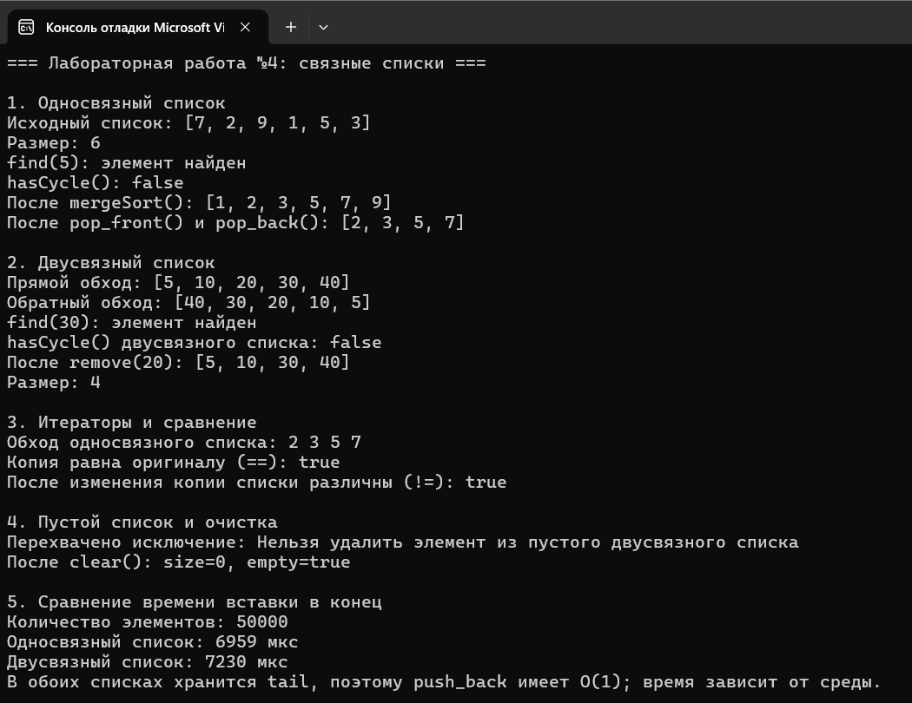

# Лабораторная работа №4
## Односвязный и двусвязный списки

**Студент:** Кулябцев Богдан Михайлович  
**Группа:** ПИЖ-б-о-25-2  
**Уровень сложности:** продвинутый  
**Вариант:** 5

---

## Цель работы

Реализовать шаблонные классы односвязного и двусвязного списков, освоить операции добавления, удаления, поиска и обхода элементов, закрепить принципы управления динамической памятью и сравнить особенности двух структур данных. Дополнительно реализовать проверку списка на наличие цикла и сортировку односвязного списка методом слияния.

---

## Теоретическая часть

### 1. Понятие связного списка

**Связный список** — структура данных, состоящая из узлов, которые не обязаны располагаться в непрерывной области памяти. Каждый узел хранит значение и указатель или указатели на соседние узлы.

В односвязном списке узел содержит указатель `next` на следующий элемент. В двусвязном списке каждый узел содержит два указателя: `next` на следующий элемент и `prev` на предыдущий.

Односвязный список:

```text
head -> [10] -> [20] -> [30] -> nullptr
```

Двусвязный список:

```text
nullptr <- [10] <-> [20] <-> [30] -> nullptr
```

### 2. Голова и хвост списка

- **`head`** — указатель на первый узел списка.
- **`tail`** — указатель на последний узел списка.
- **`count`** — количество элементов, хранящихся в списке.

Хранение `tail` позволяет добавлять элементы в конец за O(1), не проходя весь список. Для односвязного списка удаление последнего элемента всё равно требует поиска предпоследнего узла.

### 3. Сравнение динамического массива и списков

| Операция | `vector` | Односвязный список | Двусвязный список |
|---|---:|---:|---:|
| Доступ по индексу | O(1) | O(n) | O(n) |
| Вставка в начало | O(n) | O(1) | O(1) |
| Вставка в конец | O(1) амортизированно | O(1) с `tail` | O(1) с `tail` |
| Удаление из начала | O(n) | O(1) | O(1) |
| Удаление из конца | O(1) | O(n) | O(1) |
| Поиск по значению | O(n) | O(n) | O(n) |
| Память на узел | только данные | данные + 1 указатель | данные + 2 указателя |

Списки удобны, когда часто выполняются вставки и удаления в известных позициях. Динамический массив эффективнее при частом доступе по индексу и последовательном хранении данных.

### 4. Узел односвязного списка

Узел односвязного списка содержит поле данных и указатель на следующий узел:

```cpp
template<class T>
struct Node {
    T data;
    Node* next;
};
```

### 5. Узел двусвязного списка

Узел двусвязного списка содержит данные и два указателя:

```cpp
template<class T>
struct Node {
    T data;
    Node* prev;
    Node* next;
};
```

### 6. Управление памятью

Каждый узел создаётся динамически при помощи `new`. После удаления узла память освобождается оператором `delete`. Метод `clear()` последовательно удаляет все узлы, а деструктор вызывает `clear()`, чтобы не допустить утечки памяти.

Копирующие конструкторы создают независимые копии узлов. Перемещающие конструкторы передают указатели `head` и `tail`, после чего исходный объект переводится в пустое состояние. Это предотвращает совместное владение одними и теми же узлами.

### 7. Итераторы

Итератор — объект, который предоставляет последовательный доступ к элементам контейнера. В данной работе реализован вложенный класс `Iterator`.

- `begin()` возвращает итератор на первый узел.
- `end()` возвращает итератор, соответствующий `nullptr`.
- `operator*()` позволяет получить значение текущего узла.
- `operator++()` перемещает итератор к следующему узлу.

Для двусвязного списка дополнительно реализован `operator--()`, позволяющий перемещаться к предыдущему узлу, если текущий узел не равен `nullptr`.

### 8. Сортировка слиянием (`mergeSort`)

Сортировка слиянием — алгоритм «разделяй и властвуй». Список делится на две части с помощью двух указателей: медленного и быстрого. Затем каждая половина рекурсивно сортируется, после чего две отсортированные цепочки объединяются в одну.

Для односвязного списка узлы можно переставлять изменением указателей `next`, не создавая новые узлы и не копируя значения. Временная сложность алгоритма — O(n log n), дополнительная память — O(log n) на стек рекурсии.

### 9. Проверка цикла (`hasCycle`)

Для поиска цикла используется алгоритм Флойда («черепаха и заяц»). Два указателя проходят список с разной скоростью: `slow` перемещается на один узел, `fast` — на два. Если в списке есть цикл, указатели рано или поздно встретятся. Если быстрый указатель достигнет `nullptr`, цикл отсутствует.

Алгоритм выполняется за O(n) времени и использует O(1) дополнительной памяти.

---

## Постановка задачи

**Продвинутый уровень, вариант 5.**

Общее задание продвинутого уровня: реализовать оба шаблонных класса `SinglyLinkedList<T>` и `DoublyLinkedList<T>` с базовыми операциями и дополнительными требованиями.

Дополнительные требования варианта 5:
1. Для двусвязного списка реализовать `hasCycle()` — проверку наличия цикла.
2. Для односвязного списка реализовать `mergeSort()` — сортировку слиянием.

В работе также реализованы итераторы `begin()` и `end()` для обоих списков, операторы сравнения `==` и `!=`, копирование и перемещение, обработка удаления из пустого списка и демонстрация сравнения производительности.

### Реализованные возможности

**Односвязный список `SinglyLinkedList<T>`:**
- `push_front()` — вставка в начало;
- `push_back()` — вставка в конец;
- `pop_front()` — удаление первого узла;
- `pop_back()` — удаление последнего узла;
- `find()` — поиск значения;
- `remove()` — удаление узла по значению;
- `mergeSort()` — сортировка слиянием;
- `hasCycle()` — проверка наличия цикла алгоритмом Флойда;
- `clear()`, `size()`, `empty()`;
- итераторы и операторы сравнения.

**Двусвязный список `DoublyLinkedList<T>`:**
- `push_front()`, `push_back()` — вставка в начало и конец;
- `pop_front()`, `pop_back()` — удаление первого и последнего узлов;
- `find()`, `remove()` — поиск и удаление по значению;
- `insert_after()` — вставка после заданного узла;
- `hasCycle()` — проверка цикла алгоритмом Флойда;
- `print()` и `printReverse()` — прямой и обратный обход;
- `clear()`, `size()`, `empty()`;
- итераторы и операторы сравнения.

### Структура данных

| Поле | Назначение |
|---|---|
| `head` | Указатель на первый узел |
| `tail` | Указатель на последний узел |
| `count` | Количество узлов |
| `next` | Указатель на следующий узел |
| `prev` | Указатель на предыдущий узел (только двусвязный список) |

---

## Листинг программы (`lab4.cpp`)

Полный листинг программы:

```cpp
// ============================================================
// Лабораторная работа №4: связные списки
// Односвязный и двусвязный списки с итераторами, сортировкой,
// проверкой цикла и замером времени вставки.
// ============================================================

#include <iostream>    // std::cout, оператор <<
#include <stdexcept>   // std::underflow_error
#include <chrono>      // std::chrono::steady_clock, duration_cast
#include <utility>     // std::swap
#include <cstddef>     // std::size_t

// ============================================================
// ОДНОСВЯЗНЫЙ СПИСОК
// Узел хранит данные и указатель на следующий узел.
// Храним head (начало), tail (конец) и count (размер).
// ============================================================
template<class T>
class SinglyLinkedList {
    // ---------- Внутренний узел ----------
    struct Node {
        T data;                 // полезная нагрузка узла
        Node* next;             // указатель на следующий узел (nullptr у последнего)
        explicit Node(const T& v)   // explicit запрещает неявное преобразование T -> Node
            : data(v), next(nullptr) {}  // конструктор: данные = v, next = nullptr
    };

    Node* head = nullptr;       // первый элемент списка (nullptr, если список пуст)
    Node* tail = nullptr;       // последний элемент (нужен для push_back за O(1))
    std::size_t count = 0;      // текущее количество элементов

    // Обмен содержимым двух списков (используется в copy-and-swap)
    void swap(SinglyLinkedList& x) noexcept {   // noexcept — не бросает исключений
        std::swap(head,  x.head);               // меняем указатели местами
        std::swap(tail,  x.tail);               // меняем хвосты
        std::swap(count, x.count);              // меняем счётчики
    }

    // Слияние двух ОТСОРТИРОВАННЫХ цепочек узлов в одну
    static Node* merge(Node* a, Node* b) {
        Node* result = nullptr;     // голова результирующей цепочки
        Node* last   = nullptr;     // хвост результирующей цепочки
        while (a && b) {            // пока обе цепочки непусты
            Node* selected;         // узел, который пойдёт в результат
            if (a->data <= b->data) {   // если элемент из a меньше/равен
                selected = a;           // выбираем его
                a = a->next;            // сдвигаем указатель a
            } else {                    // иначе выбираем из b
                selected = b;           // берём b
                b = b->next;            // сдвигаем b
            }
            if (!result) result = selected;  // первый выбранный — голова
            else         last->next = selected;  // иначе прицепляем к хвосту
            last = selected;        // обновляем хвост результата
        }
        // Приклеиваем остаток той цепочки, которая ещё не закончилась
        if (last) last->next = a ? a : b;   // хвост указывает на остаток
        else      result     = a ? a : b;   // если результат пуст — остаток и есть результат
        return result;                       // возвращаем голову объединённой цепочки
    }

    // Рекурсивная сортировка слиянием
    static Node* sortNodes(Node* first) {
        if (!first || !first->next) return first;   // 0 или 1 элемент — уже отсортирован

        // Поиск середины: slow идёт на 1 шаг, fast — на 2
        Node* slow = first;             // медленный указатель
        Node* fast = first->next;       // быстрый указатель (стартует со второго)
        while (fast && fast->next) {    // пока fast может сделать 2 шага
            slow = slow->next;          // slow — на 1 шаг
            fast = fast->next->next;    // fast — на 2 шага
        }
        Node* right = slow->next;       // правая половина начинается после slow
        slow->next = nullptr;           // разрываем список на две части
        // Рекурсивно сортируем обе половины и сливаем
        return merge(sortNodes(first), sortNodes(right));
    }

public:
    // ---------------------------------------------------------
    // Итератор — только для чтения по порядку
    // ---------------------------------------------------------
    class Iterator {
        Node* p;                        // текущий узел
    public:
        explicit Iterator(Node* n = nullptr) : p(n) {}   // конструктор из указателя
        T& operator*()  const { return p->data; }        // разыменование: *it
        T* operator->() const { return &p->data; }       // доступ к полям: it->...
        Iterator& operator++() {                         // префиксный ++it
            if (p) p = p->next;                          // переходим к следующему узлу
            return *this;                                // возвращаем себя
        }
        Iterator operator++(int) {                       // постфиксный it++
            Iterator t = *this;                          // запоминаем копию
            ++*this;                                     // выполняем префиксный ++
            return t;                                    // возвращаем старое значение
        }
        bool operator==(Iterator x) const { return p == x.p; }  // сравнение указателей
        bool operator!=(Iterator x) const { return p != x.p; }  // неравенство
    };

    // ---------------------------------------------------------
    // Конструкторы / деструктор / присваивание
    // ---------------------------------------------------------
    SinglyLinkedList() = default;        // конструктор по умолчанию: пустой список

    // Копирующий конструктор: копируем элементы по одному
    SinglyLinkedList(const SinglyLinkedList& x) {
        try {                             // ловим возможные исключения new
            for (const T& v : x)          // проходим по всем элементам x
                push_back(v);             // добавляем копию в конец
        } catch (...) {                   // если что-то упало
            clear();                      // очищаем уже созданное
            throw;                        // пробрасываем исключение дальше
        }
    }

    // Перемещающий конструктор: "забираем" ресурсы у x
    SinglyLinkedList(SinglyLinkedList&& x) noexcept
        : head(x.head), tail(x.tail), count(x.count) {   // копируем указатели
        x.head = x.tail = nullptr;   // обнуляем источник
        x.count = 0;                 // размер источника = 0
    }

    // Копирующее присваивание через copy-and-swap (сильная гарантия)
    SinglyLinkedList& operator=(const SinglyLinkedList& x) {
        if (this != &x) {                 // защита от самоприсваивания
            SinglyLinkedList t(x);        // создаём копию
            swap(t);                      // обмениваемся с копией
        }                                 // t уничтожится и освободит старые данные
        return *this;                     // возвращаем ссылку на себя
    }

    // Перемещающее присваивание
    SinglyLinkedList& operator=(SinglyLinkedList&& x) noexcept {
        if (this != &x) {                 // защита от самоприсваивания
            clear();                      // освобождаем свои ресурсы
            head = x.head;                // забираем голову
            tail = x.tail;                // забираем хвост
            count = x.count;              // забираем размер
            x.head = x.tail = nullptr;    // обнуляем источник
            x.count = 0;                  // размер источника = 0
        }
        return *this;                     // возвращаем ссылку на себя
    }

    ~SinglyLinkedList() { clear(); }      // деструктор освобождает память

    // ---------------------------------------------------------
    // Базовые операции
    // ---------------------------------------------------------
    void push_front(const T& v) {
        Node* n = new Node(v);            // создаём новый узел
        n->next = head;                   // новый узел указывает на бывший первый
        head = n;                         // head теперь новый узел
        if (!tail) tail = n;              // если список был пуст — это и tail
        ++count;                          // увеличиваем размер
    }

    void push_back(const T& v) {
        Node* n = new Node(v);            // создаём новый узел
        if (!tail) {                      // если список пуст
            head = tail = n;              // и голова, и хвост — новый узел
        } else {                          // иначе
            tail->next = n;               // старый хвост указывает на новый
            tail = n;                     // новый узел становится хвостом
        }
        ++count;                          // увеличиваем размер
    }

    void pop_front() {
        if (!head)                        // если список пуст
            throw std::underflow_error(   // бросаем исключение
                "Нельзя удалить элемент из пустого односвязного списка");
        Node* n = head;                   // запоминаем удаляемый узел
        head = head->next;                // сдвигаем head на следующий
        delete n;                         // освобождаем память
        --count;                          // уменьшаем размер
        if (!head) tail = nullptr;        // если список опустел — tail = nullptr
    }

    void pop_back() {
        if (!head)                        // если список пуст
            throw std::underflow_error(   // бросаем исключение
                "Нельзя удалить элемент из пустого односвязного списка");
        if (head == tail) {               // единственный элемент
            delete head;                  // удаляем его
            head = tail = nullptr;        // обнуляем указатели
        } else {                          // больше одного элемента
            Node* p = head;               // начинаем с головы
            while (p->next != tail)       // ищем предпоследний узел
                p = p->next;              // двигаемся вперёд
            delete tail;                  // удаляем хвост
            tail = p;                     // предпоследний становится хвостом
            tail->next = nullptr;         // у нового хвоста next = nullptr
        }
        --count;                          // уменьшаем размер
    }

    // Поиск элемента: возвращает указатель на узел или nullptr
    Node* find(const T& v) const {
        for (Node* p = head; p; p = p->next)   // проходим по всем узлам
            if (p->data == v) return p;        // нашли — возвращаем
        return nullptr;                        // не нашли
    }

    // Удаление первого вхождения значения
    bool remove(const T& v) {
        if (!head) return false;               // пустой список — нечего удалять
        if (head->data == v) {                 // если искомое в голове
            pop_front();                       // удаляем голову
            return true;                       // успех
        }
        Node* p = head;                        // начинаем с головы
        while (p->next && !(p->next->data == v))   // ищем узел перед искомым
            p = p->next;                       // двигаемся вперёд
        if (!p->next) return false;            // дошли до конца — не нашли
        Node* n = p->next;                     // удаляемый узел
        p->next = n->next;                     // "перепрыгиваем" через него
        if (n == tail) tail = p;               // если удалили хвост — обновляем tail
        delete n;                              // освобождаем память
        --count;                               // уменьшаем размер
        return true;                           // успех
    }

    // Сортировка слиянием всего списка
    void mergeSort() {
        head = sortNodes(head);                // сортируем цепочку узлов
        tail = head;                           // начинаем поиск нового хвоста
        while (tail && tail->next)             // идём до последнего узла
            tail = tail->next;                 // двигаемся вперёд
    }

    // Проверка наличия цикла алгоритмом Флойда ("черепаха и заяц")
    bool hasCycle() const {
        Node* slow = head;                     // медленный указатель
        Node* fast = head;                     // быстрый указатель
        while (fast && fast->next) {           // пока fast может сделать 2 шага
            slow = slow->next;                 // slow — на 1 шаг
            fast = fast->next->next;           // fast — на 2 шага
            if (slow == fast) return true;     // встретились — есть цикл
        }
        return false;                          // дошли до конца — цикла нет
    }

    void clear() noexcept {                    // noexcept — не бросает исключений
        while (head) {                         // пока есть узлы
            Node* n = head->next;              // запоминаем следующий
            delete head;                       // удаляем текущий
            head = n;                          // переходим к следующему
        }
        tail = nullptr;                        // хвост обнуляем
        count = 0;                             // размер = 0
    }

    std::size_t size()  const noexcept { return count; }    // возвращает размер
    bool        empty() const noexcept { return count == 0; } // проверка на пустоту
    Iterator begin() const { return Iterator(head); }       // итератор на первый
    Iterator end()   const { return Iterator(nullptr); }    // итератор на "после последнего"

    bool operator==(const SinglyLinkedList& x) const {
        if (count != x.count) return false;    // разные размеры — не равны
        Node* a = head;                        // указатель по this
        Node* b = x.head;                      // указатель по x
        while (a && b) {                       // пока оба не кончились
            if (!(a->data == b->data)) return false;  // элементы различны
            a = a->next;                       // следующий в this
            b = b->next;                       // следующий в x
        }
        return !a && !b;                       // оба должны закончиться одновременно
    }
    bool operator!=(const SinglyLinkedList& x) const { return !(*this == x); } // отрицание ==

    void print() const {
        std::cout << "[";                      // открывающая скобка
        Node* p = head;                        // начинаем с головы
        while (p) {                            // пока есть узлы
            std::cout << p->data;              // печатаем данные
            if (p->next) std::cout << ", ";    // разделитель, если не последний
            p = p->next;                       // переходим к следующему
        }
        std::cout << "]";                      // закрывающая скобка
    }
};

// ============================================================
// ДВУСВЯЗНЫЙ СПИСОК
// Каждый узел хранит prev и next → обход в обе стороны,
// удаление найденного узла за O(1).
// ============================================================
template<class T>
class DoublyLinkedList {
    // ---------- Внутренний узел ----------
    struct Node {
        T data;                 // данные
        Node* prev;             // указатель на предыдущий узел
        Node* next;             // указатель на следующий узел
        explicit Node(const T& v)   // explicit запрещает неявное преобразование
            : data(v), prev(nullptr), next(nullptr) {}   // оба указателя nullptr
    };

    Node* head = nullptr;       // первый элемент
    Node* tail = nullptr;       // последний элемент
    std::size_t count = 0;      // количество элементов

    // Обмен содержимым двух списков
    void swap(DoublyLinkedList& x) noexcept {
        std::swap(head,  x.head);   // меняем головы
        std::swap(tail,  x.tail);   // меняем хвосты
        std::swap(count, x.count);  // меняем размеры
    }

public:
    // ---------------------------------------------------------
    // Итератор — двунаправленный
    // ---------------------------------------------------------
    class Iterator {
        Node* p;                        // текущий узел
    public:
        explicit Iterator(Node* n = nullptr) : p(n) {}   // конструктор
        T& operator*()  const { return p->data; }        // разыменование
        T* operator->() const { return &p->data; }       // доступ к полям
        Iterator& operator++() {                         // префиксный ++it
            if (p) p = p->next;                          // шаг вперёд
            return *this;                                // вернуть себя
        }
        Iterator operator++(int) {                       // постфиксный it++
            Iterator t = *this;                          // копия текущего
            ++*this;                                     // префиксный ++
            return t;                                    // вернуть старое
        }
        Iterator& operator--() {                         // префиксный --it
            if (p) p = p->prev;                          // шаг назад
            return *this;                                // вернуть себя
        }
        Iterator operator--(int) {                       // постфиксный it--
            Iterator t = *this;                          // копия
            --*this;                                     // префиксный --
            return t;                                    // вернуть старое
        }
        bool operator==(Iterator x) const { return p == x.p; }  // сравнение
        bool operator!=(Iterator x) const { return p != x.p; }  // неравенство
    };

    // ---------------------------------------------------------
    // Конструкторы / деструктор / присваивание
    // ---------------------------------------------------------
    DoublyLinkedList() = default;       // пустой список

    // Копирующий конструктор
    DoublyLinkedList(const DoublyLinkedList& x) {
        try {                           // ловим исключения
            for (const T& v : x)        // проходим по x
                push_back(v);           // добавляем копию в конец
        } catch (...) {                 // если упало
            clear();                    // очищаем
            throw;                      // пробрасываем дальше
        }
    }

    // Перемещающий конструктор
    DoublyLinkedList(DoublyLinkedList&& x) noexcept
        : head(x.head), tail(x.tail), count(x.count) {   // копируем указатели
        x.head = x.tail = nullptr;   // обнуляем источник
        x.count = 0;                 // размер источника = 0
    }

    // Копирующее присваивание через copy-and-swap
    DoublyLinkedList& operator=(const DoublyLinkedList& x) {
        if (this != &x) {               // защита от самоприсваивания
            DoublyLinkedList t(x);      // создаём копию
            swap(t);                    // обмениваемся
        }
        return *this;                   // вернуть себя
    }

    // Перемещающее присваивание
    DoublyLinkedList& operator=(DoublyLinkedList&& x) noexcept {
        if (this != &x) {               // защита от самоприсваивания
            clear();                    // освобождаем свои ресурсы
            head = x.head;              // забираем голову
            tail = x.tail;              // забираем хвост
            count = x.count;            // забираем размер
            x.head = x.tail = nullptr;  // обнуляем источник
            x.count = 0;                // размер источника = 0
        }
        return *this;                   // вернуть себя
    }

    ~DoublyLinkedList() { clear(); }    // деструктор

    // ---------------------------------------------------------
    // Базовые операции
    // ---------------------------------------------------------
    void push_front(const T& v) {
        Node* n = new Node(v);          // создаём узел
        n->next = head;                 // новый узел указывает на бывший первый
        if (head) head->prev = n;       // у бывшего первого появляется prev
        else      tail = n;             // список был пуст — это и хвост
        head = n;                       // новый узел — голова
        ++count;                        // увеличиваем размер
    }

    void push_back(const T& v) {
        Node* n = new Node(v);          // создаём узел
        n->prev = tail;                 // новый узел указывает на бывший хвост
        if (tail) tail->next = n;       // у бывшего хвоста появляется next
        else      head = n;             // список был пуст — это и голова
        tail = n;                       // новый узел — хвост
        ++count;                        // увеличиваем размер
    }

    void pop_front() {
        if (!head)                      // если список пуст
            throw std::underflow_error( // бросаем исключение
                "Нельзя удалить элемент из пустого двусвязного списка");
        Node* n = head;                 // запоминаем удаляемый
        head = head->next;              // сдвигаем голову
        if (head) head->prev = nullptr; // у новой головы prev = nullptr
        else      tail = nullptr;       // список опустел
        delete n;                       // освобождаем память
        --count;                        // уменьшаем размер
    }

    void pop_back() {
        if (!tail)                      // если список пуст
            throw std::underflow_error( // бросаем исключение
                "Нельзя удалить элемент из пустого двусвязного списка");
        Node* n = tail;                 // запоминаем удаляемый
        tail = tail->prev;              // сдвигаем хвост назад
        if (tail) tail->next = nullptr; // у нового хвоста next = nullptr
        else      head = nullptr;       // список опустел
        delete n;                       // освобождаем память
        --count;                        // уменьшаем размер
    }

    // Поиск элемента
    Node* find(const T& v) const {
        for (Node* p = head; p; p = p->next)   // проходим по всем узлам
            if (p->data == v) return p;        // нашли — возвращаем
        return nullptr;                        // не нашли
    }

    // Проверка цикла алгоритмом Флойда
    bool hasCycle() const {
        Node* slow = head;                     // медленный указатель
        Node* fast = head;                     // быстрый указатель
        while (fast && fast->next) {           // пока fast может сделать 2 шага
            slow = slow->next;                 // slow — на 1 шаг
            fast = fast->next->next;           // fast — на 2 шага
            if (slow == fast) return true;     // встретились — есть цикл
        }
        return false;                          // дошли до конца — цикла нет
    }

    // Удаление по значению (O(1) после find)
    bool remove(const T& v) {
        Node* n = find(v);              // ищем узел
        if (!n) return false;           // не нашли
        if (n == head) {                // если это голова
            pop_front();                // удаляем голову
            return true;                // успех
        }
        if (n == tail) {                // если это хвост
            pop_back();                 // удаляем хвост
            return true;                // успех
        }
        n->prev->next = n->next;        // предыдущий указывает на следующий
        n->next->prev = n->prev;        // следующий указывает на предыдущий
        delete n;                       // освобождаем память
        --count;                        // уменьшаем размер
        return true;                    // успех
    }

    // Вставка после указанного узла (вспомогательное)
    void insert_after(Node* pos, const T& v) {
        if (!pos) {                     // если позиция не задана
            push_front(v);              // вставляем в начало
            return;                     // выходим
        }
        Node* n = new Node(v);          // создаём узел
        n->prev = pos;                  // prev = заданный узел
        n->next = pos->next;            // next = следующий за заданным
        if (pos->next) pos->next->prev = n;   // если есть следующий — обновляем его prev
        else           tail = n;              // иначе новый узел — хвост
        pos->next = n;                  // заданный узел указывает на новый
        ++count;                        // увеличиваем размер
    }

    void clear() noexcept {
        while (head) {                  // пока есть узлы
            Node* n = head->next;       // запоминаем следующий
            delete head;                // удаляем текущий
            head = n;                   // переходим к следующему
        }
        tail = nullptr;                 // хвост обнуляем
        count = 0;                      // размер = 0
    }

    std::size_t size()  const noexcept { return count; }     // размер
    bool        empty() const noexcept { return count == 0; } // пустота
    Iterator begin() const { return Iterator(head); }        // итератор на первый
    Iterator end()   const { return Iterator(nullptr); }     // итератор на "после последнего"

    bool operator==(const DoublyLinkedList& x) const {
        if (count != x.count) return false;    // разные размеры
        Node* a = head;                        // указатель по this
        Node* b = x.head;                      // указатель по x
        while (a && b) {                       // пока оба не кончились
            if (!(a->data == b->data)) return false;  // элементы различны
            a = a->next;                       // следующий в this
            b = b->next;                       // следующий в x
        }
        return !a && !b;                       // оба закончились одновременно
    }
    bool operator!=(const DoublyLinkedList& x) const { return !(*this == x); } // отрицание ==

    void print() const {
        std::cout << "[";                      // открывающая скобка
        Node* p = head;                        // начинаем с головы
        while (p) {                            // пока есть узлы
            std::cout << p->data;              // печатаем данные
            if (p->next) std::cout << ", ";    // разделитель
            p = p->next;                       // переходим к следующему
        }
        std::cout << "]";                      // закрывающая скобка
    }

    void printReverse() const {
        std::cout << "[";                      // открывающая скобка
        Node* p = tail;                        // начинаем с хвоста
        while (p) {                            // пока есть узлы
            std::cout << p->data;              // печатаем данные
            if (p->prev) std::cout << ", ";    // разделитель
            p = p->prev;                       // идём назад
        }
        std::cout << "]";                      // закрывающая скобка
    }
};

// ============================================================
// main — демонстрация работы
// ============================================================
int main() {
    std::cout << "=== Лабораторная работа №4: связные списки ===\n\n";

    // ---------- 1. Односвязный ----------
    std::cout << "1. Односвязный список\n";
    SinglyLinkedList<int> s;                       // создаём список
    for (int x : {7, 2, 9, 1, 5, 3})               // для каждого значения
        s.push_back(x);                            // добавляем в конец
    std::cout << "Исходный список: ";              // подпись
    s.print();                                     // печатаем
    std::cout << "\nРазмер: " << s.size() << "\n"; // печатаем размер
    std::cout << "find(5): "                       // подпись
              << (s.find(5) ? "элемент найден" : "не найден") << "\n";  // результат поиска
    std::cout << "hasCycle(): "                    // подпись
              << (s.hasCycle() ? "true" : "false") << "\n";              // результат проверки

    s.mergeSort();                                 // сортируем список
    std::cout << "После mergeSort(): ";            // подпись
    s.print();                                     // печатаем
    std::cout << "\n";

    s.pop_front();                                 // удаляем первый
    s.pop_back();                                  // удаляем последний
    std::cout << "После pop_front() и pop_back(): ";   // подпись
    s.print();                                     // печатаем
    std::cout << "\n";

    // ---------- 2. Двусвязный ----------
    std::cout << "\n2. Двусвязный список\n";
    DoublyLinkedList<int> d;                       // создаём список
    for (int x : {10, 20, 30, 40})                 // для каждого значения
        d.push_back(x);                            // добавляем в конец
    d.push_front(5);                               // добавляем 5 в начало
    std::cout << "Прямой обход: ";                 // подпись
    d.print();                                     // печать с начала
    std::cout << "\nОбратный обход: ";             // подпись
    d.printReverse();                              // печать с конца
    std::cout << "\n";
    std::cout << "find(30): "                      // подпись
              << (d.find(30) ? "элемент найден" : "не найден") << "\n";  // результат поиска
    std::cout << "hasCycle() двусвязного списка: " // подпись
              << (d.hasCycle() ? "true" : "false") << "\n";              // результат проверки

    d.remove(20);                                  // удаляем 20
    std::cout << "После remove(20): ";             // подпись
    d.print();                                     // печатаем
    std::cout << "\nРазмер: " << d.size() << "\n"; // печатаем размер

    // ---------- 3. Итераторы и сравнение ----------
    std::cout << "\n3. Итераторы и сравнение\nОбход односвязного списка: ";
    for (auto it = s.begin(); it != s.end(); ++it) // проходим итератором
        std::cout << *it << " ";                   // печатаем элемент
    std::cout << "\n";

    SinglyLinkedList<int> copy = s;                // копирующий конструктор
    std::cout << "Копия равна оригиналу (==): "    // подпись
              << (copy == s ? "true" : "false") << "\n";   // сравнение
    copy.push_back(100);                           // меняем копию
    std::cout << "После изменения копии списки различны (!=): "  // подпись
              << (copy != s ? "true" : "false") << "\n";         // сравнение

    // ---------- 4. Пустой список и очистка ----------
    std::cout << "\n4. Пустой список и очистка\n";
    DoublyLinkedList<int> empty;                   // пустой список
    try {                                          // пытаемся
        empty.pop_back();                          // удалить из пустого
    } catch (const std::underflow_error& e) {      // ловим исключение
        std::cout << "Перехвачено исключение: "    // подпись
                  << e.what() << "\n";             // текст исключения
    }
    d.clear();                                     // очищаем d
    std::cout << "После clear(): size=" << d.size()  // размер после очистки
              << ", empty=" << (d.empty() ? "true" : "false") << "\n";  // проверка пустоты

    // ---------- 5. Замер времени push_back ----------
    std::cout << "\n5. Сравнение времени вставки в конец\n";
    const int N = 50000;                           // количество элементов

    auto a = std::chrono::steady_clock::now();     // время до односвязного
    SinglyLinkedList<int> bs;                      // создаём односвязный
    for (int i = 0; i < N; ++i)                    // N раз
        bs.push_back(i);                           // добавляем в конец
    auto b = std::chrono::steady_clock::now();     // время после односвязного

    DoublyLinkedList<int> bd;                      // создаём двусвязный
    for (int i = 0; i < N; ++i)                    // N раз
        bd.push_back(i);                           // добавляем в конец
    auto c = std::chrono::steady_clock::now();     // время после двусвязного

    auto us1 = std::chrono::duration_cast<std::chrono::microseconds>(b - a).count();  // мкс для односвязного
    auto us2 = std::chrono::duration_cast<std::chrono::microseconds>(c - b).count();  // мкс для двусвязного
    std::cout << "Количество элементов: " << N << "\n"           // N
              << "Односвязный список: " << us1 << " мкс\n"       // время 1
              << "Двусвязный список: " << us2 << " мкс\n";       // время 2
    std::cout << "В обоих списках хранится tail, поэтому push_back имеет O(1); "
                 "время зависит от среды.\n";

    return 0;                                      // успешное завершение
}

```

---

## Результаты работы

### Вывод программы




### Анализ результата

- **Блок 1. Односвязный список.** Создан список из шести элементов. Проверены размер, поиск значения и отсутствие цикла. Метод `mergeSort()` отсортировал элементы по возрастанию. Затем удалены первый и последний элементы.
- **Блок 2. Двусвязный список.** Продемонстрированы вставка в начало и конец, прямой и обратный обход, поиск и удаление элемента по значению. Проверка `hasCycle()` вернула `false`, поскольку список построен без циклических ссылок.
- **Блок 3. Итераторы и сравнение.** Элементы односвязного списка выведены через итератор. Копия списка сначала равна оригиналу, а после добавления нового элемента оператор `!=` показывает различие.
- **Блок 4. Обработка пустого списка.** Попытка удалить элемент из пустого двусвязного списка приводит к `std::underflow_error`. Исключение перехватывается. После `clear()` размер равен нулю.
- **Блок 5. Производительность.** Измерено время добавления 50 000 элементов в конец обоих списков. Оба класса хранят указатель `tail`, поэтому асимптотическая сложность `push_back()` составляет O(1). Конкретное время зависит от аппаратного обеспечения, компилятора и нагрузки системы.

---


## Ответы на контрольные вопросы

1. **Чем связный список отличается от динамического массива?**  
   В динамическом массиве элементы располагаются в непрерывной области памяти, поэтому доступ по индексу выполняется за O(1). В связном списке узлы могут находиться в разных местах памяти и связаны указателями. Доступ к элементу по позиции требует последовательного обхода и занимает O(n).

2. **Какие операции в односвязном списке выполняются за O(1)?**  
   Вставка в начало, удаление из начала, получение `head`, а также вставка в конец при наличии указателя `tail`. Если адрес нужного узла уже известен, изменение его ссылки также может выполняться за O(1).

3. **Почему удаление из конца односвязного списка требует O(n) времени?**  
   Каждый узел односвязного списка хранит только ссылку на следующий узел. Чтобы удалить последний элемент и обновить `tail`, необходимо найти предпоследний узел. Для этого список проходится от `head`, что занимает O(n).

4. **Какие преимущества даёт хранение указателя `tail` в односвязном списке?**  
   Указатель `tail` позволяет сразу обращаться к последнему узлу. Благодаря этому добавление элемента в конец выполняется за O(1), а не требует полного обхода списка.

5. **Чем двусвязный список отличается от односвязного?**  
   В односвязном списке узел хранит указатель только на следующий элемент. В двусвязном — на следующий и предыдущий. Благодаря `prev` двусвязный список поддерживает обратный обход и удаление известного узла за O(1), но требует дополнительной памяти.

6. **Какие операции в двусвязном списке выполняются быстрее, чем в односвязном?**  
   Удаление последнего элемента выполняется за O(1), поскольку `tail->prev` сразу указывает на предыдущий узел. Также проще удалять известный узел из середины и выполнять обратный обход. В односвязном списке для удаления узла обычно требуется найти предыдущий.

7. **Что такое «голова» (`head`) и «хвост» (`tail`) списка?**  
   `head` — указатель на первый узел, `tail` — указатель на последний. Для пустого списка оба указателя равны `nullptr`.

8. **Как удалить узел из середины односвязного списка?**  
   Нужно найти предыдущий узел, сохранить указатель на удаляемый узел, перенаправить `previous->next` на `deleted->next`, затем освободить память удаляемого узла. Если удаляется последний узел, необходимо обновить `tail`.

9. **Как удалить узел из середины двусвязного списка? Почему это проще?**  
   Если адрес узла известен, достаточно связать его соседей: `node->prev->next = node->next` и `node->next->prev = node->prev`, после чего удалить узел. Отдельно обрабатываются случаи удаления `head` и `tail`. Это проще, потому что ссылка на предыдущий узел уже хранится в `prev`.

10. **Что произойдёт, если забыть обновить `tail` при удалении?**  
    `tail` будет указывать на освобождённую или уже не последнюю область памяти. Последующие операции добавления или удаления могут привести к повреждению структуры, неопределённому поведению и аварийному завершению программы.

11. **Как реализовать реверс односвязного списка?**  
    Используется три указателя: `previous`, `current` и `next`. На каждом шаге сохраняется следующий узел, ссылка текущего узла разворачивается на предыдущий, затем указатели сдвигаются. После обхода `head` становится бывшим `tail`. Время выполнения — O(n), дополнительная память — O(1).

12. **Как обнаружить цикл в связном списке?**  
    Можно использовать алгоритм Флойда: медленный указатель проходит по одному узлу, быстрый — по два. Если указатели встретились, цикл существует. Если быстрый указатель дошёл до `nullptr`, цикла нет. Время — O(n), дополнительная память — O(1).

13. **В каких случаях стоит использовать список вместо массива?**  
    Список удобен, когда часто добавляют и удаляют элементы в начале или в известных позициях и не требуется быстрый доступ по индексу. Массив предпочтительнее при частом индексном доступе и необходимости компактного расположения данных в памяти.

14. **Какая дополнительная память требуется для каждого узла списка?**  
    Односвязный узел хранит один указатель `next`, двусвязный — два указателя `prev` и `next`. Помимо этого каждый узел хранит само значение и служебные накладные расходы распределителя памяти.

15. **Почему доступ по индексу в списке имеет сложность O(n)?**  
    Узлы не расположены в непрерывной памяти и не имеют прямой адресации по индексу. Чтобы получить элемент с номером `i`, необходимо пройти от головы через предыдущие узлы, поэтому в худшем случае потребуется O(n) переходов.

---

## Вывод

В ходе лабораторной работы были реализованы шаблонные классы односвязного и двусвязного списков. Были закреплены операции вставки, удаления, поиска и обхода элементов, а также правила безопасного управления динамической памятью. Для односвязного списка реализована сортировка слиянием `mergeSort()`, а для двусвязного — проверка цикла `hasCycle()` алгоритмом Флойда. Дополнительно реализованы итераторы, сравнение списков, копирование и перемещение. Сравнение показало, что оба списка с указателем `tail` поддерживают вставку в конец за O(1), однако удаление последнего узла односвязного списка требует O(n), а двусвязного — O(1). Таким образом, выбор структуры данных зависит от набора операций, которые чаще всего выполняются программой.

---
