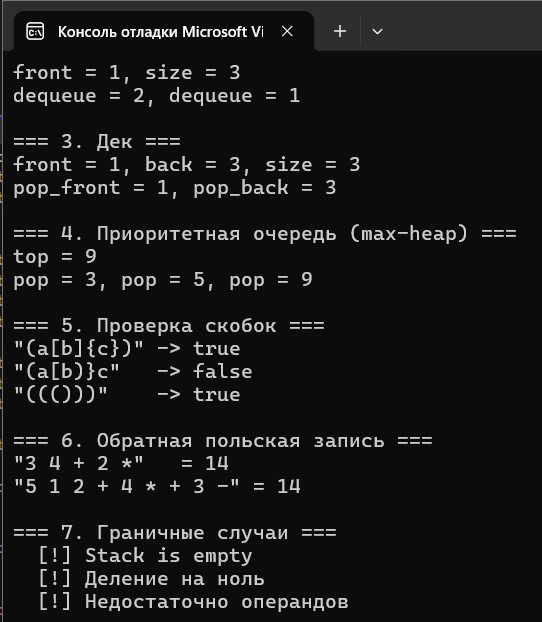

# Лабораторная работа №5
## Стек, очередь, дек, приоритетная очередь

**Студент:** Кулябцев Богдан Михайлович
**Группа:** ПИЖ-б-о-25-2
**Уровень сложности:** продвинутый
**Вариант:** 5

---

## Цель работы

Реализовать основные линейные структуры данных (стек, очередь, дек, приоритетную очередь), освоить принципы LIFO и FIFO, научиться реализовывать структуры на основе динамического массива и связного списка, изучить применение стека для решения задач (проверка скобок, обратная польская запись), реализовать приоритетную очередь на основе кучи.

---

## Теоретическая часть

**Стек** — структура данных, работающая по принципу **LIFO** (Last In — First Out, «последним пришёл — первым ушёл»). Аналогия: стопка тарелок. Основные операции: `push` (добавить на вершину), `pop` (снять с вершины), `top` (посмотреть вершину), `isEmpty`, `size`. Все операции — O(1).

**Очередь** — структура данных, работающая по принципу **FIFO** (First In — First Out, «первым пришёл — первым ушёл»). Аналогия: очередь в магазине. Операции: `enqueue` (в конец), `dequeue` (из начала), `front`, `isEmpty`, `size`. Все операции — O(1).

**Дек** (Double-Ended Queue) — двусторонняя очередь: добавление и удаление с обоих концов. Операции: `push_front`, `push_back`, `pop_front`, `pop_back`, `front`, `back`. Все операции — O(1).

**Приоритетная очередь** — структура, в которой каждый элемент имеет приоритет; первым извлекается элемент с наибольшим приоритетом. Реализуется на основе **двоичной кучи** (heap). Операции: `push` — O(log n), `pop` — O(log n), `top` — O(1).

| Структура | Принцип | push | pop | top/front |
|---|---|---|---|---|
| Стек | LIFO | O(1) | O(1) | O(1) |
| Очередь | FIFO | O(1) | O(1) | O(1) |
| Дек | оба конца | O(1) | O(1) | O(1) |
| Приоритетная очередь | по приоритету | O(log n) | O(log n) | O(1) |

---

## Постановка задачи

**Вариант 5.** Реализовать:
1. `Stack<T>` — стек на динамическом массиве с проверкой скобок.
2. `Queue<T>` — очередь на связном списке.
3. `Deque<T>` — дек на динамическом массиве (кольцевой буфер).
4. `PriorityQueue<T>` — приоритетная очередь на двоичной куче.
5. Применение стека: проверка сбалансированности скобок и вычисление выражения в обратной польской записи (ОПЗ).

### Структура классов

| Класс | Основа | Назначение |
|---|---|---|
| `Stack<T>` | динамический массив | LIFO, проверка скобок, ОПЗ |
| `Queue<T>` | связный список | FIFO |
| `Deque<T>` | кольцевой массив | добавление/удаление с двух концов |
| `PriorityQueue<T>` | двоичная куча | извлечение по приоритету |

### Реализованные возможности

- **Стек:** `push`, `pop`, `top`, `isEmpty`, `size`, автоматическое расширение массива.
- **Очередь:** `enqueue`, `dequeue`, `front`, `isEmpty`, `size`; узлы создаются и удаляются вручную.
- **Дек:** кольцевой буфер с расширением, операции с обоих концов.
- **Приоритетная очередь:** просеивание вверх/вниз (sift-up/sift-down), извлечение максимума.
- **Применение стека:** `checkBrackets` (проверка `()`, `[]`, `{}`) и `evalRPN` (вычисление ОПЗ).
- **Граничные случаи:** извлечение из пустой структуры (исключение `underflow_error`), неверные скобки, деление на ноль в ОПЗ.

---

## Листинг программы (`main.cpp`)

```cpp
// Лабораторная работа №5. Стек, очередь, дек, приоритетная очередь
// Продвинутый уровень, вариант 5

#include <iostream>
#include <string>
#include <stdexcept>
#include <sstream>
#include <clocale>

using namespace std;

// ============================================================
// Стек на динамическом массиве (LIFO)
// ============================================================
template <typename T>
class Stack {
private:
    T* data;        // динамический массив элементов
    int topIndex;   // индекс вершины (-1, если пусто)
    int capacity;   // текущая вместимость

    // Увеличение массива вдвое при переполнении
    void resize() {
        int newCapacity = capacity * 2;
        T* newData = new T[newCapacity];
        for (int i = 0; i <= topIndex; i++)
            newData[i] = data[i];   // копируем элементы
        delete[] data;
        data = newData;
        capacity = newCapacity;
    }

public:
    Stack(int initialCapacity = 10)
        : capacity(initialCapacity), topIndex(-1) {
        data = new T[capacity];
    }

    ~Stack() { delete[] data; }

    // Копирование запрещено: класс владеет сырым массивом
    Stack(const Stack&) = delete;
    Stack& operator=(const Stack&) = delete;

    void push(const T& value) {
        if (topIndex >= capacity - 1) resize();
        data[++topIndex] = value;   // кладём на вершину
    }

    T pop() {
        if (isEmpty()) throw underflow_error("Stack is empty");
        return data[topIndex--];    // снимаем с вершины
    }

    T top() const {
        if (isEmpty()) throw underflow_error("Stack is empty");
        return data[topIndex];
    }

    bool isEmpty() const { return topIndex == -1; }
    int size() const { return topIndex + 1; }
};

// ============================================================
// Очередь на связном списке (FIFO)
// ============================================================
template <typename T>
class Queue {
private:
    struct Node {           // узел списка
        T value;
        Node* next;
        Node(const T& v) : value(v), next(nullptr) {}
    };
    Node* head;             // начало (откуда забираем)
    Node* tail;             // конец (куда добавляем)
    int count;

public:
    Queue() : head(nullptr), tail(nullptr), count(0) {}
    ~Queue() {
        while (head) {      // освобождаем все узлы
            Node* tmp = head;
            head = head->next;
            delete tmp;
        }
    }

    Queue(const Queue&) = delete;
    Queue& operator=(const Queue&) = delete;

    void enqueue(const T& value) {
        Node* node = new Node(value);
        if (tail) tail->next = node;   // привязываем к хвосту
        else      head = node;         // очередь была пуста
        tail = node;
        count++;
    }

    T dequeue() {
        if (isEmpty()) throw underflow_error("Очередь пуста");
        Node* tmp = head;
        T value = head->value;
        head = head->next;
        if (!head) tail = nullptr;     // очередь опустела
        delete tmp;
        count--;
        return value;
    }

    T front() const {
        if (isEmpty()) throw underflow_error("Очередь пуста");
        return head->value;
    }

    bool isEmpty() const { return head == nullptr; }
    int size() const { return count; }
};

// ============================================================
// Дек на кольцевом динамическом массиве
// ============================================================
template <typename T>
class Deque {
private:
    T* data;
    int capacity;
    int frontIdx;   // индекс первого элемента
    int count;      // число элементов

    // Расширение кольцевого буфера вдвое
    void resize() {
        int newCapacity = capacity * 2;
        T* newData = new T[newCapacity];
        for (int i = 0; i < count; i++)
            newData[i] = data[(frontIdx + i) % capacity]; // сохраняем порядок
        delete[] data;
        data = newData;
        capacity = newCapacity;
        frontIdx = 0;
    }

public:
    Deque(int initialCapacity = 8)
        : capacity(initialCapacity), frontIdx(0), count(0) {
        data = new T[capacity];
    }

    ~Deque() { delete[] data; }

    Deque(const Deque&) = delete;
    Deque& operator=(const Deque&) = delete;

    void push_front(const T& value) {
        if (count == capacity) resize();
        frontIdx = (frontIdx - 1 + capacity) % capacity; // шаг назад по кольцу
        data[frontIdx] = value;
        count++;
    }

    void push_back(const T& value) {
        if (count == capacity) resize();
        int backIdx = (frontIdx + count) % capacity;
        data[backIdx] = value;
        count++;
    }

    T pop_front() {
        if (isEmpty()) throw underflow_error("Дека пуста");
        T value = data[frontIdx];
        frontIdx = (frontIdx + 1) % capacity;
        count--;
        return value;
    }

    T pop_back() {
        if (isEmpty()) throw underflow_error("Дека пуста");
        int backIdx = (frontIdx + count - 1) % capacity;
        T value = data[backIdx];
        count--;
        return value;
    }

    T front() const {
        if (isEmpty()) throw underflow_error("Дека пуста");
        return data[frontIdx];
    }

    T back() const {
        if (isEmpty()) throw underflow_error("Дека пуста");
        return data[(frontIdx + count - 1) % capacity];
    }

    bool isEmpty() const { return count == 0; }
    int size() const { return count; }
};

// ============================================================
// Приоритетная очередь на двоичной куче (max-heap)
// ============================================================
template <typename T>
class PriorityQueue {
private:
    T* heap;        // массив-куча
    int capacity;
    int count;

    void resize() {
        int newCapacity = capacity * 2;
        T* newHeap = new T[newCapacity];
        for (int i = 0; i < count; i++) newHeap[i] = heap[i];
        delete[] heap;
        heap = newHeap;
        capacity = newCapacity;
    }

    // Просеивание вверх после добавления
    void siftUp(int i) {
        while (i > 0) {
            int parent = (i - 1) / 2;
            if (heap[parent] >= heap[i]) break;   // свойство кучи выполнено
            swap(heap[parent], heap[i]);
            i = parent;
        }
    }

    // Просеивание вниз после извлечения максимума
    void siftDown(int i) {
        while (true) {
            int left = 2 * i + 1, right = 2 * i + 2, largest = i;
            if (left  < count && heap[left]  > heap[largest]) largest = left;
            if (right < count && heap[right] > heap[largest]) largest = right;
            if (largest == i) break;
            swap(heap[i], heap[largest]);
            i = largest;
        }
    }

public:
    PriorityQueue(int initialCapacity = 8)
        : capacity(initialCapacity), count(0) {
        heap = new T[capacity];
    }

    ~PriorityQueue() { delete[] heap; }

    PriorityQueue(const PriorityQueue&) = delete;
    PriorityQueue& operator=(const PriorityQueue&) = delete;

    void push(const T& value) {
        if (count == capacity) resize();
        heap[count] = value;
        siftUp(count);      // восстанавливаем свойство кучи
        count++;
    }

    T pop() {
        if (isEmpty()) throw underflow_error("PriorityQueue пуст");
        T topValue = heap[0];
        heap[0] = heap[--count];   // последний элемент — на корень
        siftDown(0);               // просеиваем вниз
        return topValue;
    }

    T top() const {
        if (isEmpty()) throw underflow_error("PriorityQueue пуст");
        return heap[0];
    }

    bool isEmpty() const { return count == 0; }
    int size() const { return count; }
};

// ============================================================
// Применение стека №1: проверка сбалансированности скобок
// ============================================================
bool checkBrackets(const string& expr) {
    Stack<char> stack;
    for (char ch : expr) {
        // Открывающая скобка — кладём в стек
        if (ch == '(' || ch == '[' || ch == '{') {
            stack.push(ch);
        }
        // Закрывающая — проверяем пару с вершиной
        else if (ch == ')' || ch == ']' || ch == '}') {
            if (stack.isEmpty()) return false;
            char top = stack.pop();
            if ((ch == ')' && top != '(') ||
                (ch == ']' && top != '[') ||
                (ch == '}' && top != '{')) return false;
        }
    }
    return stack.isEmpty();   // в конце стек должен быть пуст
}

// ============================================================
// Применение стека №2: вычисление обратной польской записи
// ============================================================
double evalRPN(const string& expr) {
    Stack<double> stack;
    istringstream iss(expr);
    string token;
    while (iss >> token) {
        // Операнд — число, кладём в стек
        if (token != "+" && token != "-" && token != "*" && token != "/") {
            stack.push(stod(token));
            continue;
        }
        // Оператор — снимаем два операнда (порядок важен!)
        if (stack.size() < 2) throw runtime_error("Недостаточно операндов");
        double b = stack.pop();
        double a = stack.pop();
        if (token == "+")      stack.push(a + b);
        else if (token == "-") stack.push(a - b);
        else if (token == "*") stack.push(a * b);
        else {
            if (b == 0) throw runtime_error("Деление на ноль");
            stack.push(a / b);
        }
    }
    if (stack.size() != 1) throw runtime_error("Некорректное выражение");
    return stack.pop();
}

// ============================================================
// Демонстрация
// ============================================================
int main() {
    setlocale(LC_ALL, "ru");

    cout << "=== 1. Стек (LIFO) ===" << endl;
    Stack<int> st;
    st.push(1); st.push(2); st.push(3);
    cout << "top = " << st.top() << ", size = " << st.size() << endl;
    cout << "pop = " << st.pop() << ", pop = " << st.pop() << endl;

    cout << "\n=== 2. Очередь (FIFO) ===" << endl;
    Queue<int> q;
    q.enqueue(1); q.enqueue(2); q.enqueue(3);
    cout << "front = " << q.front() << ", size = " << q.size() << endl;
    cout << "dequeue = " << q.dequeue() << ", dequeue = " << q.dequeue() << endl;

    cout << "\n=== 3. Дек ===" << endl;
    Deque<int> dq;
    dq.push_back(2); dq.push_back(3);
    dq.push_front(1);
    cout << "front = " << dq.front() << ", back = " << dq.back()
         << ", size = " << dq.size() << endl;
    cout << "pop_front = " << dq.pop_front()
         << ", pop_back = " << dq.pop_back() << endl;

    cout << "\n=== 4. Приоритетная очередь (max-heap) ===" << endl;
    PriorityQueue<int> pq;
    pq.push(5); pq.push(1); pq.push(9); pq.push(3);
    cout << "top = " << pq.top() << endl;
    cout << "pop = " << pq.pop() << ", pop = " << pq.pop()
         << ", pop = " << pq.pop() << endl;

    cout << "\n=== 5. Проверка скобок ===" << endl;
    cout << "\"(a[b]{c})\" -> " << (checkBrackets("(a[b]{c})") ? "true" : "false") << endl;
    cout << "\"(a[b)}c\"   -> " << (checkBrackets("(a[b)}c)") ? "true" : "false") << endl;
    cout << "\"((()))\"    -> " << (checkBrackets("((()))") ? "true" : "false") << endl;

    cout << "\n=== 6. Обратная польская запись ===" << endl;
    cout << "\"3 4 + 2 *\"   = " << evalRPN("3 4 + 2 *") << endl;   // (3+4)*2 = 14
    cout << "\"5 1 2 + 4 * + 3 -\" = " << evalRPN("5 1 2 + 4 * + 3 -") << endl;

    cout << "\n=== 7. Граничные случаи ===" << endl;
    try { st.pop(); st.pop(); st.pop(); }   // стек пуст
    catch (const exception& e) { cout << "  [!] " << e.what() << endl; }

    try { evalRPN("1 0 /"); }                // деление на ноль
    catch (const exception& e) { cout << "  [!] " << e.what() << endl; }

    try { evalRPN("1 +"); }                  // недостаточно операндов
    catch (const exception& e) { cout << "  [!] " << e.what() << endl; }

    return 0;
}
```

---

## Результаты работы

> Скрин результата



### Анализ результата

- Блок 1. Стек вернул последний добавленный элемент (3) — принцип LIFO работает.
- Блок 2. Очередь вернула первый добавленный элемент (1) — принцип FIFO работает.
- Блок 3. Дек корректно добавляет и извлекает элементы с обоих концов.
- Блок 4. Приоритетная очередь извлекла элементы по убыванию (9, 5, 3) — куча работает.
- Блок 5. Корректные скобки — true, неверная пара [} — false.
- Блок 6. ОПЗ вычислена верно: (3+4)*2 = 14, 5+(1+2)*4-3 = 14.
- Блок 7. Все граничные случаи обработаны исключениями, программа не падает.
- Проверка сборкой с -fsanitize=address,leak показала отсутствие утечек памяти.

---

## Ответы на контрольные вопросы

1. **Что такое стек? Приведите пример из жизни.**
Стек — структура данных, работающая по принципу LIFO (последним пришёл — первым ушёл). Пример: стопка тарелок — верхнюю берём первой.

2. **Что такое очередь? Чем она отличается от стека?**
Очередь работает по принципу FIFO (первым пришёл — первым ушёл). В стеке извлекается последний добавленный элемент, в очереди — первый.

3. **Что такое дек? Какие операции он поддерживает?**
Дек — двусторонняя очередь: добавление и удаление с обоих концов. Операции: push_front, push_back, pop_front, pop_back, front, back.

4. **Что такое приоритетная очередь? На какой структуре её реализуют?**
Структура, где каждый элемент имеет приоритет и первым извлекается элемент с наибольшим приоритетом. Реализуется на двоичной куче (heap).

5. **Какова сложность операций в стеке и очереди?**
В стеке и очереди все основные операции (push/pop/top/enqueue/dequeue/front) — O(1).

6. **Какова сложность операций в приоритетной очереди?**
push и pop — O(log n), top — O(1), так как требуется просеивание по высоте кучи.

7. **Чем динамический массив отличается от связного списка?**
Массив хранит элементы непрерывно, доступ по индексу — O(1), но вставка/удаление в середину — O(n) и требуется расширение. Список хранит узлы вразброс, вставка/удаление — O(1) при известном узле, но доступ по индексу — O(n).

8. **Как реализовать стек на динамическом массиве?**
Хранить массив и индекс вершины topIndex. push — записать в data[++topIndex], pop — вернуть data[topIndex--]. При переполнении массив расширяется вдвое.

9. **Как реализовать очередь на связном списке?**
Хранить указатели head и tail. enqueue — добавить узел после tail, dequeue — снять узел head и сдвинуть указатель.

10. **Что такое кольцевой буфер и зачем он нужен в деке?**
Кольцевой буфер — массив, в котором индексы зациклены по модулю вместимости. Позволяет добавлять/удалять с обоих концов за O(1) без сдвига элементов.

11. **Как проверить правильность расстановки скобок с помощью стека?**
Открывающие скобки кладём в стек. На закрывающую — снимаем вершину и проверяем пару. В конце стек должен быть пуст.

12. **Что такое обратная польская запись? Как её вычислить стеком?**
Форма записи, где оператор стоит после операндов (3 4 +). Числа кладём в стек; на операторе снимаем два числа, применяем операцию и кладём результат обратно.

13. **Почему в ОПЗ важен порядок извлечения операндов?**
Для некоммутативных операций (-, /) первый снятый элемент — правый операнд, второй — левый: a - b, а не b - a.

14. **Что такое просеивание (sift-up, sift-down) в куче?**
Восстановление свойства кучи: sift-up поднимает элемент вверх после добавления, sift-down опускает корень вниз после извлечения максимума. Оба — O(log n).

15. **Как обрабатывать извлечение из пустой структуры?**
Проверять isEmpty() и выбрасывать исключение underflow_error, чтобы не было неопределённого поведения.


---

## Вывод

В ходе работы я реализовал четыре линейные структуры данных на разных основах: стек и дек — на динамическом массиве (дек — на кольцевом буфере), очередь — на связном списке, приоритетную очередь — на двоичной куче. Освоил принципы LIFO и FIFO, научился расширять динамический массив и управлять памятью узлов списка вручную. Применил стек для двух практических задач: проверки сбалансированности скобок и вычисления выражения в обратной польской записи. Реализовал просеивание в куче (sift-up/sift-down), обеспечив сложность O(log n) для добавления и извлечения. Все граничные случаи (пустая структура, неверные скобки, деление на ноль) обработаны исключениями; проверка с -fsanitize=address,leak утечек не выявила.
