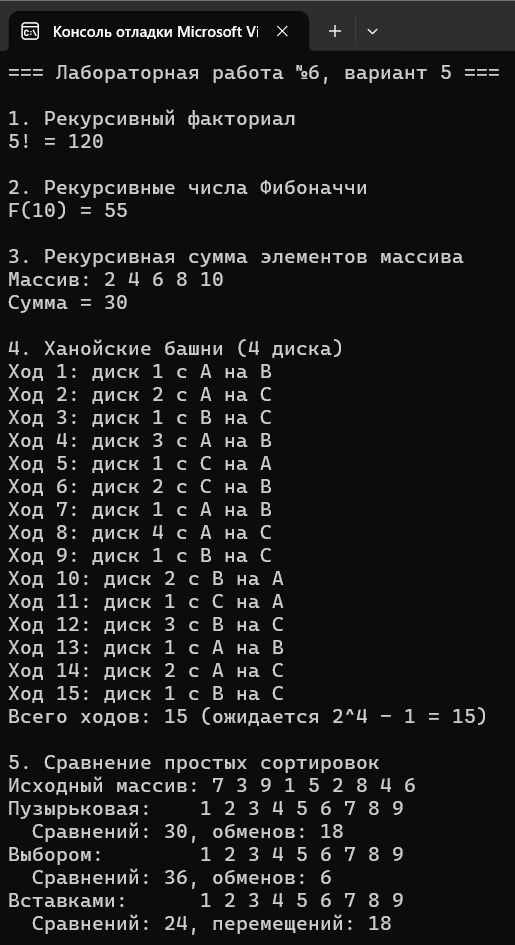

# Лабораторная работа №6
## Рекурсивные алгоритмы. Простые сортировки

**Студент:** Кулябцев Богдан Михайлович  
**Группа:** ПИЖ-б-о-25-2  
**Уровень сложности:** продвинутый  
**Вариант:** 5

---

## Цель работы

Изучить рекурсивные алгоритмы, научиться применять рекурсию для решения задач, реализовать простые сортировки и сравнить их по количеству сравнений и обменов.

## Теоретическая часть

**Рекурсия** — способ решения задачи, при котором функция вызывает саму себя для обработки подзадачи меньшего размера. Рекурсивная функция содержит базовый случай (условие остановки) и шаг рекурсии.

**Факториал:** `n! = n · (n−1)!`, при `0! = 1`. Время `O(n)`, глубина стека `O(n)`.

**Числа Фибоначчи:** `F(0)=0`, `F(1)=1`, `F(n)=F(n−1)+F(n−2)`. Наивная рекурсия имеет экспоненциальное время `O(2^n)` и глубину `O(n)`.

**Рекурсивная сумма массива:** функция прибавляет текущий элемент к сумме оставшейся части. Время `O(n)`, глубина стека `O(n)`.

**Ханойские башни:** для переноса `n` дисков сначала переносят `n−1` дисков на вспомогательный стержень, затем самый большой диск, после чего `n−1` дисков на целевой стержень. Число ходов `T(n)=2T(n−1)+1=2^n−1`, время `O(2^n)`. Для 4 дисков требуется 15 ходов.

## Постановка задачи

**Вариант 5. Часть 1 — рекурсивные алгоритмы:**
1. Вычислить факториал числа.
2. Вычислить число Фибоначчи.
3. Найти сумму элементов массива рекурсивно.
4. Решить задачу Ханойских башен для 4 дисков.

**Часть 2 — простые сортировки:** вариант требует пузырьковую сортировку и сортировку выбором; дополнительное задание — подсчитать количество сравнений и обменов. С учётом общего перечня требований и критериев методички также реализована сортировка вставками.

## Реализованные возможности

- Рекурсивный факториал с базовым случаем.
- Рекурсивное вычисление числа Фибоначчи.
- Рекурсивная сумма элементов массива.
- Рекурсивное решение Ханойских башен для 4 дисков с выводом каждого хода.
- Пузырьковая сортировка с подсчётом сравнений и обменов, с ранним завершением.
- Сортировка выбором с подсчётом сравнений и обменов.
- Сортировка вставками; отдельно подсчитываются сравнения и перемещения.

## Листинг программы (`main.cpp`)

```cpp
// Лабораторная работа №6. Рекурсивные алгоритмы. Простые сортировки
// Продвинутый уровень, вариант 5
// Рекурсивные задачи: факториал, Фибоначчи, сумма массива, Ханойские башни (4 диска).
// Сортировки: пузырьковая, выбором и вставками; для пузырьковой и выбором
// считаются сравнения и обмены (дополнительное задание варианта 5).

#include <iostream>
#include <vector>
#include <cstdlib>
#include <ctime>
#include <algorithm>
#include <clocale>
using namespace std;

// 1. Рекурсивный факториал
long long factorial(int n) {
    if (n <= 1) return 1;              // базовый случай
    return n * factorial(n - 1);       // шаг рекурсии
}

// 2. Рекурсивное число Фибоначчи (для небольших n)
long long fibonacci(int n) {
    if (n <= 1) return n;              // базовые случаи
    return fibonacci(n - 1) + fibonacci(n - 2);
}

// 3. Рекурсивная сумма элементов массива
int sumArray(const vector<int>& arr, int index) {
    if (index == static_cast<int>(arr.size())) return 0; // массив закончился
    return arr[index] + sumArray(arr, index + 1);
}

// 4. Ханойские башни для четырёх дисков
void hanoi(int n, char from, char to, char auxiliary, int& moves) {
    if (n == 1) {
        ++moves;
        cout << "Ход " << moves << ": диск 1 с " << from << " на " << to << '\n';
        return;
    }
    hanoi(n - 1, from, auxiliary, to, moves);
    ++moves;
    cout << "Ход " << moves << ": диск " << n << " с " << from << " на " << to << '\n';
    hanoi(n - 1, auxiliary, to, from, moves);
}

struct SortStats {
    long long comparisons = 0;
    long long swaps = 0;
};

// Пузырьковая сортировка с подсчётом сравнений и обменов
void bubbleSort(vector<int>& a, SortStats& stats) {
    for (size_t i = 0; i + 1 < a.size(); ++i) {
        bool swapped = false;
        for (size_t j = 0; j + 1 < a.size() - i; ++j) {
            ++stats.comparisons;
            if (a[j] > a[j + 1]) {
                swap(a[j], a[j + 1]);
                ++stats.swaps;
                swapped = true;
            }
        }
        if (!swapped) break; // если обменов не было, массив уже отсортирован
    }
}

// Сортировка выбором с подсчётом сравнений и обменов
void selectionSort(vector<int>& a, SortStats& stats) {
    for (size_t i = 0; i + 1 < a.size(); ++i) {
        size_t minIndex = i;
        for (size_t j = i + 1; j < a.size(); ++j) {
            ++stats.comparisons;
            if (a[j] < a[minIndex]) minIndex = j;
        }
        if (minIndex != i) {
            swap(a[i], a[minIndex]);
            ++stats.swaps;
        }
    }
}

// Сортировка вставками — включена также для выполнения общего перечня требований методички
void insertionSort(vector<int>& a, SortStats& stats) {
    for (size_t i = 1; i < a.size(); ++i) {
        int key = a[i];
        int j = static_cast<int>(i) - 1;
        while (j >= 0) {
            ++stats.comparisons;
            if (a[j] <= key) break;
            a[j + 1] = a[j];
            ++stats.swaps; // учитываем перемещение элемента как операцию перестановки
            --j;
        }
        a[j + 1] = key;
    }
}

void printArray(const vector<int>& a) {
    for (int value : a) cout << value << ' ';
    cout << '\n';
}

int main() {
    setlocale(LC_ALL, "");

    cout << "=== Лабораторная работа №6, вариант 5 ===\n";
    cout << "\n1. Рекурсивный факториал\n";
    cout << "5! = " << factorial(5) << '\n';

    cout << "\n2. Рекурсивные числа Фибоначчи\n";
    cout << "F(10) = " << fibonacci(10) << '\n';

    cout << "\n3. Рекурсивная сумма элементов массива\n";
    vector<int> values = {2, 4, 6, 8, 10};
    cout << "Массив: "; printArray(values);
    cout << "Сумма = " << sumArray(values, 0) << '\n';

    cout << "\n4. Ханойские башни (4 диска)\n";
    int moves = 0;
    hanoi(4, 'A', 'C', 'B', moves);
    cout << "Всего ходов: " << moves << " (ожидается 2^4 - 1 = 15)\n";

    cout << "\n5. Сравнение простых сортировок\n";
    vector<int> original = {7, 3, 9, 1, 5, 2, 8, 4, 6};
    cout << "Исходный массив: "; printArray(original);

    vector<int> bubble = original;
    SortStats bubbleStats;
    bubbleSort(bubble, bubbleStats);
    cout << "Пузырьковая:    "; printArray(bubble);
    cout << "  Сравнений: " << bubbleStats.comparisons << ", обменов: " << bubbleStats.swaps << '\n';

    vector<int> selection = original;
    SortStats selectionStats;
    selectionSort(selection, selectionStats);
    cout << "Выбором:        "; printArray(selection);
    cout << "  Сравнений: " << selectionStats.comparisons << ", обменов: " << selectionStats.swaps << '\n';

    vector<int> insertion = original;
    SortStats insertionStats;
    insertionSort(insertion, insertionStats);
    cout << "Вставками:      "; printArray(insertion);
    cout << "  Сравнений: " << insertionStats.comparisons << ", перемещений: " << insertionStats.swaps << '\n';

    return 0;
}

```

## Результаты работы

> Скрин результата


## Анализ сложности

| Алгоритм | Время | Дополнительная память |
|---|---:|---:|
| Факториал (рекурсивный) | O(n) | O(n) стек |
| Фибоначчи (наивная рекурсия) | O(2^n) | O(n) стек |
| Сумма массива (рекурсивная) | O(n) | O(n) стек |
| Ханойские башни | O(2^n) | O(n) стек |
| Пузырьковая сортировка | O(n²), лучший O(n) | O(1) |
| Сортировка выбором | O(n²) | O(1) |
| Сортировка вставками | O(n²), лучший O(n) | O(1) |

## Сравнение сортировок на тестовом массиве

Исходный массив: `7 3 9 1 5 2 8 4 6`.

| Сортировка | Сравнения | Обмены / перемещения |
|---|---:|---:|
| Пузырьковая | 30 | 18 обменов |
| Выбором | 36 | 6 обменов |
| Вставками | 24 | 18 перемещений |

На данном массиве сортировка выбором выполняет меньше обменов, так как делает не более одного обмена на проход. Пузырьковая сортировка прекращает работу раньше, если за проход не было обменов. Сортировка вставками на этом наборе выполнила меньше сравнений. Результаты относятся к конкретному массиву и не являются универсальным рейтингом алгоритмов.

## Ответы на контрольные вопросы

1. **Что такое рекурсия? Из каких компонентов состоит рекурсивная функция?** Рекурсия — вызов функцией самой себя. Она состоит из базового случая и рекурсивного шага, который уменьшает задачу.
2. **Что такое базовый случай и почему он важен?** Это условие, при котором функция прекращает вызовы. Без него рекурсия может стать бесконечной и привести к переполнению стека.
3. **Чем отличается прямая рекурсия от косвенной?** При прямой функция вызывает себя; при косвенной одна функция вызывает другую, которая в итоге вызывает первую.
4. **Что такое хвостовая рекурсия?** Рекурсивный вызов является последней операцией функции. Некоторые компиляторы могут оптимизировать её, однако C++ не гарантирует такую оптимизацию.
5. **Какова временная сложность рекурсивного Фибоначчи?** Экспоненциальная, обычно оценивается `O(2^n)`, потому что подзадачи многократно вычисляются повторно.
6. **Как оптимизировать Фибоначчи?** Использовать итеративный алгоритм или мемоизацию, чтобы не вычислять значения повторно.
7. **В чём отличие рекурсивной реализации от итеративной?** Рекурсивная использует вызовы функций и стек; итеративная повторяет действия в цикле, обычно с меньшими накладными расходами памяти.
8. **Сложность пузырьковой сортировки? Когда O(n)?** Средняя и худшая `O(n²)`, лучшая `O(n)` при проверке, что за проход не было обменов, если массив уже отсортирован.
9. **Чем вставки отличаются от выбора?** Вставки перемещают элементы, чтобы вставить очередной в отсортированную часть; выбор ищет минимум в оставшейся части и меняет его с текущим элементом.
10. **Какие простые сортировки устойчивы?** Пузырьковая и вставками — при корректном сравнении; устойчивость означает сохранение относительного порядка равных элементов. Сортировка выбором обычно неустойчива.
11. **Какая сортировка лучше на почти отсортированных данных?** Обычно сортировка вставками; пузырьковая с ранним завершением тоже может работать за `O(n)` на полностью отсортированном массиве.
12. **Как оптимизировать пузырьковую сортировку?** Отслеживать флаг обмена и прекращать циклы, если обменов не было.
13. **Что такое backtracking?** Рекурсивный поиск решения, при котором при неудаче отменяют сделанный выбор и пробуют другой.
14. **Как рекурсивно обойти лабиринт?** Проверять границы, стены и посещённые клетки; отмечать текущую клетку и рекурсивно переходить к соседям, возвращаясь при тупике.
15. **Сложность Ханойских башен и число ходов?** `O(2^n)`; минимальное число ходов `2^n−1`. Для четырёх дисков — 15.

## Вывод

В ходе лабораторной работы реализованы четыре рекурсивные задачи: факториал, число Фибоначчи, сумма массива и Ханойские башни. Изучены базовые случаи и шаги рекурсии. Реализованы пузырьковая сортировка, сортировка выбором и вставками. Для пузырьковой сортировки и сортировки выбором подсчитаны сравнения и обмены. Полученные результаты подтвердили корректность алгоритмов на тестовых данных и позволили сравнить их поведение.
