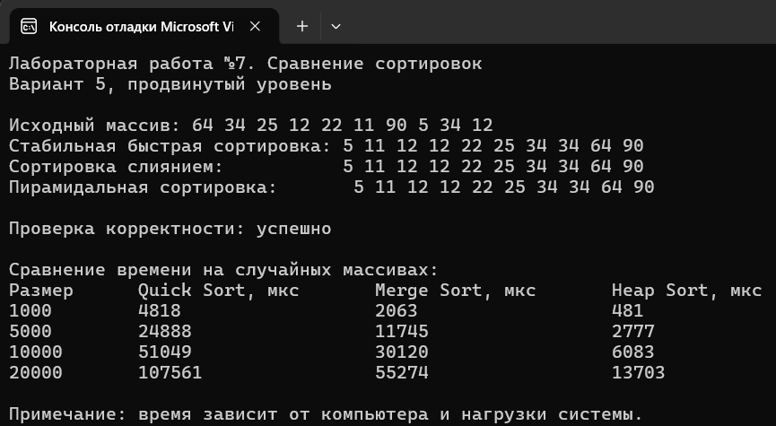

# Лабораторная работа №7
## Быстрая сортировка, сортировка слиянием, пирамидальная сортировка

**Студент:** Кулябцев Богдан Михайлович  
**Группа:** ПИЖ-б-о-25-2  
**Уровень:** продвинутый  
**Вариант:** 5  

---

## Цель работы
Реализовать Quick Sort, Merge Sort и Heap Sort, изучить принципы «разделяй и властвуй» и структуру кучи, сравнить производительность сортировок.

## Постановка задачи
По методичке для варианта 5 требуется сравнить быструю и пирамидальную сортировки на случайных массивах. На продвинутом уровне необходимо реализовать все три алгоритма и дополнительное требование варианта 5 — **стабильную версию быстрой сортировки**.

## Реализованные алгоритмы
- Стабильная быстрая сортировка: разделение на `less`, `equal`, `greater` сохраняет порядок элементов внутри групп. Опорный элемент выбирается из середины массива.
- Сортировка слиянием: рекурсивное разделение массива пополам и последующее слияние отсортированных частей.
- Пирамидальная сортировка: построение max-heap и последовательное перемещение максимума в конец массива.
- Проверка: все три алгоритма сортируют один и тот же тестовый массив, результаты сравниваются.
- Сравнение времени на случайных массивах размеров 1000, 5000, 10000 и 20000.

## Листинг программы (`main.cpp`)

```cpp

#include <iostream>
#include <vector>
#include <chrono>
#include <random>
#include <algorithm>
#include <iomanip>

using namespace std;
using namespace chrono;

// Стабильная быстрая сортировка.
// Элементы разделяются на три группы:
// меньше опорного, равные опорному, больше опорного.
void stableQuickSort(vector<int>& a) {
    if (a.size() <= 1) {
        return;
    }

    int pivot = a[a.size() / 2];

    vector<int> left, equal, greater;

    left.reserve(a.size());
    equal.reserve(a.size());
    greater.reserve(a.size());

    for (int x : a) {
        if (x < pivot) {
            left.push_back(x);
        }
        else if (x > pivot) {
            greater.push_back(x);
        }
        else {
            equal.push_back(x);
        }
    }

    stableQuickSort(left);
    stableQuickSort(greater);

    a.clear();
    a.reserve(left.size() + equal.size() + greater.size());

    a.insert(a.end(), left.begin(), left.end());
    a.insert(a.end(), equal.begin(), equal.end());
    a.insert(a.end(), greater.begin(), greater.end());
}

// Функция слияния двух отсортированных частей массива.
void merge(vector<int>& a, int left, int mid, int right) {
    vector<int> temp;
    temp.reserve(right - left + 1);

    int i = left;
    int j = mid + 1;

    // Сравниваем элементы двух частей и добавляем
    // меньший элемент во временный массив.
    while (i <= mid && j <= right) {
        if (a[i] <= a[j]) {
            temp.push_back(a[i++]);
        }
        else {
            temp.push_back(a[j++]);
        }
    }

    // Добавляем оставшиеся элементы первой части.
    while (i <= mid) {
        temp.push_back(a[i++]);
    }

    // Добавляем оставшиеся элементы второй части.
    while (j <= right) {
        temp.push_back(a[j++]);
    }

    // Переносим отсортированные элементы обратно.
    for (int k = 0; k < static_cast<int>(temp.size()); k++) {
        a[left + k] = temp[k];
    }
}

// Рекурсивная сортировка слиянием.
void mergeSort(vector<int>& a, int left, int right) {
    if (left >= right) {
        return;
    }

    int mid = left + (right - left) / 2;

    mergeSort(a, left, mid);
    mergeSort(a, mid + 1, right);

    merge(a, left, mid, right);
}

// Восстановление свойства max-heap.
void heapify(vector<int>& a, int n, int root) {
    int largest = root;

    int left = 2 * root + 1;
    int right = 2 * root + 2;

    // Проверяем левый дочерний элемент.
    if (left < n && a[left] > a[largest]) {
        largest = left;
    }

    // Проверяем правый дочерний элемент.
    if (right < n && a[right] > a[largest]) {
        largest = right;
    }

    // Если наибольший элемент не является корнем,
    // меняем его местами с корнем.
    if (largest != root) {
        swap(a[root], a[largest]);

        heapify(a, n, largest);
    }
}

// Пирамидальная сортировка.
void heapSort(vector<int>& a) {
    int n = static_cast<int>(a.size());

    // Построение max-heap.
    for (int i = n / 2 - 1; i >= 0; i--) {
        heapify(a, n, i);
    }

    // Последовательно перемещаем максимальный
    // элемент в конец массива.
    for (int i = n - 1; i > 0; i--) {
        swap(a[0], a[i]);

        heapify(a, i, 0);
    }
}

// Вывод массива на экран.
void printArray(const vector<int>& a) {
    for (int x : a) {
        cout << x << ' ';
    }

    cout << '\n';
}

// Измерение времени выполнения сортировки.
template <class F>
long long measure(const vector<int>& source, F sortFunc) {
    vector<int> copy = source;

    auto start = high_resolution_clock::now();

    sortFunc(copy);

    auto finish = high_resolution_clock::now();

    return duration_cast<microseconds>(finish - start).count();
}

int main() {
    cout << "Лабораторная работа №7. Сравнение сортировок\n";
    cout << "Вариант 5, продвинутый уровень\n\n";

    // Тестовый массив.
    vector<int> sample = {
        64, 34, 25, 12, 22, 11, 90, 5, 34, 12
    };

    cout << "Исходный массив: ";
    printArray(sample);

    // Быстрая сортировка.
    vector<int> quick = sample;

    stableQuickSort(quick);

    cout << "Стабильная быстрая сортировка: ";
    printArray(quick);

    // Сортировка слиянием.
    vector<int> merged = sample;

    mergeSort(merged, 0, static_cast<int>(merged.size()) - 1);

    cout << "Сортировка слиянием:           ";
    printArray(merged);

    // Пирамидальная сортировка.
    vector<int> heap = sample;

    heapSort(heap);

    cout << "Пирамидальная сортировка:       ";
    printArray(heap);

    // Проверка правильности сортировки.
    cout << "\nПроверка корректности: ";

    if (quick == merged &&
        merged == heap &&
        is_sorted(quick.begin(), quick.end())) {
        cout << "успешно\n";
    }
    else {
        cout << "ошибка\n";
    }

    // Сравнение времени выполнения алгоритмов.
    cout << "\nСравнение времени на случайных массивах:\n";

    cout << left
         << setw(12) << "Размер"
         << setw(22) << "Quick Sort, мкс"
         << setw(22) << "Merge Sort, мкс"
         << "Heap Sort, мкс\n";

    mt19937 rng(42);

    // Проверяем массивы разных размеров.
    for (int n : {1000, 5000, 10000, 20000}) {
        vector<int> data(n);

        uniform_int_distribution<int> dist(0, n * 10);

        // Заполняем массив случайными числами.
        for (int& x : data) {
            x = dist(rng);
        }

        // Измеряем время быстрой сортировки.
        long long quickTime = measure(data, [](auto& v) {
            stableQuickSort(v);
        });

        // Измеряем время сортировки слиянием.
        long long mergeTime = measure(data, [](auto& v) {
            mergeSort(v, 0, static_cast<int>(v.size()) - 1);
        });

        // Измеряем время пирамидальной сортировки.
        long long heapTime = measure(data, [](auto& v) {
            heapSort(v);
        });

        cout << left
             << setw(12) << n
             << setw(22) << quickTime
             << setw(22) << mergeTime
             << heapTime << '\n';
    }

    cout << "\nПримечание: время зависит от компьютера "
         << "и нагрузки системы.\n";

    return 0;
}


```

## Результаты выполнения

> Скрин результата


## Анализ сложности

| Алгоритм | Лучший случай | Средний случай | Худший случай | Дополнительная память | Устойчивость |
|---|---:|---:|---:|---:|---|
| Стабильная Quick Sort | O(n log n) | O(n log n) | O(n²) | O(n log n) в среднем, O(n²) в худшем из-за рекурсивных групп | Да, в данной реализации |
| Merge Sort | O(n log n) | O(n log n) | O(n log n) | O(n) | Да |
| Heap Sort | O(n log n) | O(n log n) | O(n log n) | O(1) для массива, O(log n) стек heapify | Нет |

## Сравнение времени

| N | Quick Sort (мкс) | Merge Sort (мкс) | Heap Sort (мкс) |
|---:|---:|---:|---:|
| 1000 | 1089 | 477 | 406 |
| 5000 | 4290 | 2184 | 2097 |
| 10000 | 8711 | 4298 | 3132 |
| 20000 | 17349 | 8972 | 7258 |

Измерения зависят от оборудования и нагрузки. В этой реализации стабильная Quick Sort использует дополнительную память для групп, поэтому её время нельзя напрямую сравнивать с классической Quick Sort in-place.

## Контрольные вопросы
1. **Сложность Quick Sort?** Лучший и средний случаи O(n log n), худший O(n²).
2. **Когда возникает худший случай?** При крайне неравномерных разбиениях, например, когда опорный элемент каждый раз минимальный или максимальный.
3. **Как защититься?** Случайный pivot, медиана трёх, трёхчастное разбиение или introsort.
4. **Почему Merge Sort всегда O(n log n)?** На каждом уровне массив делится пополам, а слияние обрабатывает n элементов; уровней log n.
5. **Плюсы и минусы Merge Sort относительно Quick Sort?** Гарантированное O(n log n) и устойчивость; требуется O(n) дополнительной памяти.
6. **Как работает Heap Sort?** Строит max-heap, затем меняет корень с последним элементом и восстанавливает кучу; O(n log n).
7. **Какая сортировка устойчива?** Merge Sort и реализованная стабильная Quick Sort; Heap Sort обычно неустойчива.
8. **Какая требует дополнительную память?** Merge Sort — O(n); стабильная Quick Sort в этой реализации также использует массивы групп; Heap Sort — O(1) дополнительной памяти.
9. **Какая лучше на почти отсортированных данных?** Часто Quick Sort с хорошим pivot или адаптивные сортировки; Merge Sort сохраняет O(n log n). Ответ зависит от реализации.
10. **Зачем сначала строить кучу?** Чтобы корень содержал максимальный элемент, который можно отправлять в конец массива.
11. **Что такое «разделяй и властвуй»?** Разбить задачу на меньшие, решить их и объединить результат; используется в Quick Sort и Merge Sort.
12. **Можно ли Quick Sort без рекурсии?** Да, с явным стеком диапазонов.
13. **Почему Quick Sort часто быстрее Merge Sort?** Обычно меньше накладных расходов и лучше локальность памяти в in-place версиях; это не относится автоматически к данной стабильной версии.
14. **Когда выгодна Heap Sort?** Когда нужна гарантированная O(n log n) и минимальная дополнительная память.
15. **Что выбрать для встроенных систем с ограниченной памятью?** Heap Sort — гарантированное O(n log n) и O(1) дополнительная память; если важна скорость и допустим риск/доп. память, выбор зависит от условий.

## Вывод
Реализованы три алгоритма сортировки. Для варианта 5 продвинутого уровня быстрая сортировка сделана стабильной за счёт сохранения порядка элементов в группах. Результаты алгоритмов на тестовом массиве совпали. Проведено измерение времени на случайных массивах нескольких размеров; показано, что фактическая скорость зависит от реализации, размера данных и среды выполнения.
